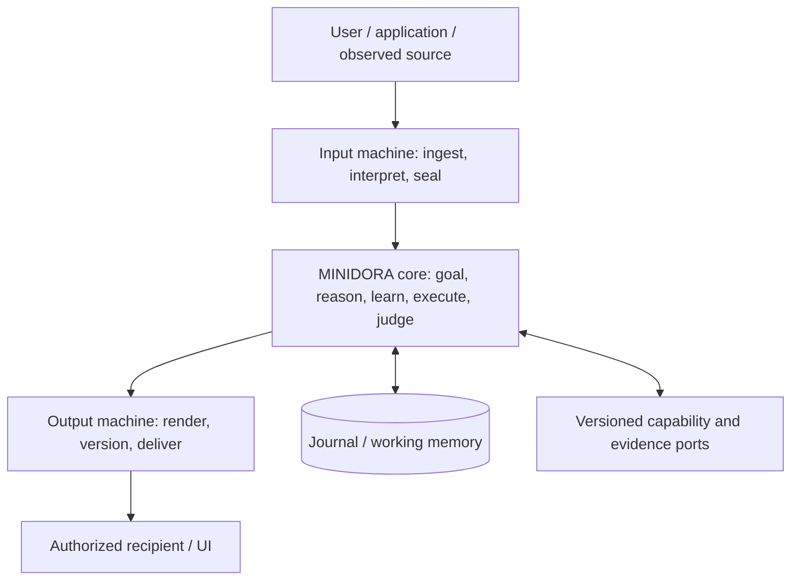

# MINIDORA — Unified Engine Redesign Specification

**Specification ID:** `MINIDORA-UNIFIED-SPEC-R1`  
**Date:** 2026-11-09 (JST)  
**Status:** Concrete architectural design, **not yet implemented or accepted**  
**Design owner:** MINIDORA architecture review; the choices below are made in this specification, not delegated to an implementation agent.  
**Target:** A separately versioned successor in `gatchimuchio/MINIDORA-BETA` only. The original repository is read-only.  
**Public/private boundary:** Public execution behavior and interfaces only; no unpublished HDS definitions, complete internal abstraction or theory-to-source crosswalk.

## 0. Decision and reading contract

MINIDORA is redesigned as **one non-neural, deterministic, stateful language-and-execution engine**, with **three non-overlapping machine responsibilities**:

1. **Input machine / 入力機:** Read heterogeneous input, preserve the original, determine a one-time typed interpretation, and seal it.
2. **MINIDORA core / ミニドラ本体:** Own all goal control, meaning/relation computations, the non-neural language model, memory, inference, learning, adaptation, execution, evidence adoption and final internal judgment.
3. **Output machine / 出力機:** Transform an already judged content plan into text/media, manage output versions/invalidation, and deliver **only with explicit authorization**.

These three responsibilities are **fixed**. They follow the user's 2026-10-28 decision, not an assumption inherited from the beta code. The beta may be reorganized internally, but a second judgment/learning loop in an adapter, retrieval provider or renderer is forbidden. The old term “HDS compiler” may survive in compatible Python symbols, but new architecture documentation uses **input machine**, **core**, **output machine**.

This is the **sole normative architectural specification** for the successor candidate. The [capability register](02_CAPABILITY_REGISTER.md), [verification contract](05_VERIFICATION_AND_EVIDENCE.md) and [lineage record](06_LINEAGE_AND_DECISIONS.md) are evidence/coverage annexes, **not a specification–schedule–agent-instruction three-piece set**. No construction plan or Codex work order is part of the current design authority.

## 1. Objective, invariants and measurable result

**Objective:** An arbitrary authorized request must be interpreted from its real source, executed using appropriate existing or composable capabilities, and return a substantive and traceable result, or a truthful, typed refusal/suspension/failure. A user does not need to select the internal module or translate their request into test-specific structures.

**Invariants** (`MUST` means mandatory for the successor's declared supported scope):

- `I01` Preserve source subject, purpose, context, conditions, negation, temporal bounds, scope, identity and constraints. Derived interpretations cannot erase their origin.
- `I02` Treat user instructions, retrieved material, supplied observations, internally derived claims and guesses as different authority/evidence classes.
- `I03` Only the core may choose/execute actions, update the goal, adopt learning, or issue the final internal terminal judgment. Input and output machinery cannot do this indirectly.
- `I04` A successful local action, generated answer text, memory insertion or changed state signature does not establish user-goal completion.
- `I05` Every factual claim adopted for output has a versioned source, a declared problem premise, or a valid derivation with inspectable dependencies; otherwise the claim is explicitly hypothetical or withheld.
- `I06` Memory is persistent and auditable; relevant working state is bounded. Corrections append new versions and invalidate descendants without destroying prior records.
- `I07` A fixed input/model/state/capability/source packet and deterministic configuration reproduce the same core decisions and content; external LIVE variation is separate evidence.
- `I08` Unknown, suspended, rejected, failed, cancelled and successful operations remain distinct from display and delivery success.
- `I09` New capabilities must compose without retraining or replacing the non-neural core model; external neural services cannot be silently attributed to MINIDORA's intrinsic performance.
- `I10` Publication excludes private HDS theory and source-level reconstruction maps. Japanese meaning/implementation identifiers stay canonical; public explanations remain English.

**Non-goals:** Artificially maximizing module count; treating fluent text as proof of truth; always producing an answer; converting an external provider's capability into a claim about the core; equating a test scaffold with natural-language competence; declaring AGI or GPT parity from incomplete comparisons.

## 2. Architectural decisions (not deferred)

| Decision | Selected design | Reason/explicit trade-off |
|---|---|---|
| `D01` Boundaries | Three machines with a **single authoritative core** | Existing fixed owner contract; avoid duplicate decisions across adapters |
| `D02` Runtime | **Python 3.11+** for initial successor; existing public 414-file code is the reuse baseline | Preserves compatibility/engineering investment; native backend allowed only behind a proven replaceable contract |
| `D03` State | **Event journal + immutable revisions + bounded working projections** | Preserve all history while avoiding computing over every historic item each turn |
| `D04` Local persistence | **SQLite WAL** with atomic revisions, content-addressed evidence blobs and explicit migration | Cross-process crash recovery and CPU/Windows-first operation without an external database requirement |
| `D05` Serialization | **Canonical UTF-8 JSON** for public records; typed scalar representations; SHA-256 content digests | Auditable round-trip and portable hashes; avoid non-deterministic float, object identity and dictionary insertion order |
| `D06` Reasoning | **Typed, provenance-carrying relation graph and explicit rule/operation composition** | Preserve agency, conditions and support; lexical similarity alone cannot grant fact status |
| `D07` Non-neural LM | Sequence/context distribution plus explicit deterministic decoder **inside the core**, with claim planning separate from phrasing | Preserve non-neural model identity without letting sampled words invent unsupported claims |
| `D08` Learning | In-core **memory → inference → adaptation**, with proof/validation, dependency invalidation and controlled future-use measurement | Learning is a general execution property, not an external plug-in or retry trick |
| `D09` Retrieval | Versioned **search-list and fetched-body evidence packets**, separate LIVE/replay modes | Source drift and retrieval failure become measurable causes, not hidden algorithm changes |
| `D10` Orchestration | **Goal/required-artifact dependency graph**, finite action scheduler, one state revision owner | Multi-step effects are credited only when actually produced and consumed toward the goal |
| `D11` External abilities | Typed, versioned capability ports with permission/cost/failure contracts | Math, science, Web, files and future multimedia use one execution controller |
| `D12` Content delivery | Adopted **content plan** → deterministic surface rendering → optional explicit delivery receipt | Preserve answer meaning; do not perform a second reasoning/adoption pass in output machine |
| `D13` Portability target | CPU-first, Windows-first, functional on an **8 GB system** with measurable upper bounds and explicit overload behavior | Practical user environment; quality and throughput cannot be assumed from architecture |
| `D14` Product entry points | One core state for CLI, HTTP, browser, conversation and external applications | Prevent mutually inconsistent product chat state and beta-facade state |

The selected implementation technology is an engineering proposal, not a claim that the existing beta already meets the successor contracts. A change to a design decision requires a new specification revision with measured cause and compatibility impact; an implementer cannot silently override the architecture.

## 3. System topology and authority



**Input machine owns:** Source intake, normalization (without changing meaning), origin and permission labels, at-most-once baseline interpretation per input version, sealed `InputBundle`, diagnostics. It cannot mutate core memory or grant an external document instructional authority.

**Core owns:** `GoalContract`, task/capability selection, factual and hypothetical relation states, language-model computations, evidence evaluation, actual action results, work-state mutation, learning/adaptation, progress/stop, output-plan adoption and all persistent core revisions. It is the **only writer** of the logical case state.

**Output machine owns:** Presentation formatting, content versioning and invalidation, media conversion, finite authorized delivery, acknowledgments and delivery failures. It may reject an invalid rendering/delivery envelope; it **cannot** upgrade a hypothesis to fact, reinterpret the goal, launch retrieval, retry core reasoning or self-commit a learning rule.

**Capability port owns:** Execution of a specific typed operation within an explicit time/effect budget. It returns an observed value, uncertainty, resource consumption and failure. It does **not** write the final goal state or decide the overall answer.

**Memory service:** A storage and indexing implementation **owned logically by the core**, not a fourth cognitive authority. The full historical journal and the active working set are different objects.

## 4. Contract types and identity

Define immutable logical values (names denote public concepts; implementation can reuse existing Japanese classes if they satisfy the contract):

```text
RequestEnvelope {
  case_id, input_id, input_version, session_id,
  actor_id, role, source_kind, channel, modality, locale,
  raw_blob_sha256, raw_size, observed_at, content_type,
  explicit_permissions[], previous_result_ref?, context_ref?,
  request_contract_version
}
InputBundle {
  request_ref, original_blob_ref, context_snapshot_ref,
  interpretation: MeaningIR, diagnostic[], interpretation_version,
  semantic_signature, sealed_at
}
MeaningIR {
  speech_act, goal_intent, output_requirements[],
  entities[], relations[], coreferences[], quoted_claims[],
  source_spans[], premises[], negations[], scope[], time[],
  constraints[], unresolved[], confidence_class, source_ref
}
Relation {
  subject_ref, predicate_id, argument_roles[], polarity,
  world_id, quantifier, modality, condition_refs[], temporal_scope,
  provenance_refs[], derivation_refs[], guarantee_class
}
GoalContract {
  goal_id, instruction_ref, intended_artifacts[],
  completion_predicates[], forbidden_effects[], authority_scope,
  deadline?, resource_budget, policy_version, immutable_goal_sha256
}
CapabilityPort {
  capability_id, version, input_schema, output_schema,
  effect_class, permission_requirement, cost_budget,
  timeout, retry_contract, cancellation_contract, determinism_class
}
ActionRecord {
  action_id, case_revision, goal_id, capability_id, capability_version,
  exact_input_refs[], actual_output_refs[], effect_receipt?,
  resource_usage, start/end_time, observed_state_delta,
  failure_signature?, dependency_refs[]
}
EvidencePacket {
  packet_id, query_ref, provider_id/version, request_fingerprint,
  search_rank?, source_uri?, document_version?, page_span?,
  http_status, retry_sequence[], failure_stage?, captured_at,
  raw_body_sha256?, raw_body_ref?, parser_version?, extracted_span_refs[],
  independence_group, source_kind, license_constraints
}
LearningRecord {
  formation_id, origin_evidence_refs[], premises[], conclusion?,
  transformation?, conditions[], scope, dependency_rule_versions[],
  guarantee_class, validation_refs[], counterexample_refs[],
  adoption_state, adopted_at?, invalidated_at?, future_use_refs[]
}
ContentPlan {
  result_id, goal_id, terminal_state, required_content_units[],
  claim_refs[], evidence_refs[], style/format/locale,
  known_limits[], withheld_claims[], output_version
}
OutputEnvelope {
  case_id, output_id, judgment_version, content_plan_ref,
  content_sha256, rendering_contract, delivery_intent,
  delivery_authority_ref?, invalidation_parent?
}
DeliveryReceipt {
  delivery_id, output_ref, destination_ref, authorization_ref,
  prepared_at, attempted_at?, acknowledgement?, terminal_delivery_state
}
```

**Identity law:** `(case_id, input_id, input_version)` identifies a *single logical accepted input*. The same key with differing raw/context/permission fingerprints is a conflict, not an overwrite. A retry after an observed failure is a **new input version** or an explicitly idempotent resume against the same saved action identity; neither permits silently running a possibly completed external effect twice.

**Version law:** Separate input, evidence, goal, model, rule, capability, case, content, output and delivery revisions. Changing display style may create a new output rendering without a new factual decision; new source evidence must create a new evidence packet and dependent judgment revision.

**Canonicalization law:** Sort record keys and unordered sets; encode Unicode as UTF-8; preserve source bytes separately; represent exact numbers with integer/rational/decimal strings and explicit units; disallow NaN, infinity and environment-dependent object serialization; hash with a versioned canonicalizer ID. Wall-clock IDs are trace metadata, not part of the fixed-core behavioral-equality predicate.

## 5. Core state and single-writer discipline

The core's working projection is:

```text
CaseState = {
  case_revision, request_ref, immutable_goal_ref, current_input_ref,
  current_meaning_ref, active_claim_graph_ref,
  active_evidence_refs[], unresolved_goal_nodes[],
  required_artifact_graph, action_frontier[],
  capability_registry_snapshot, policy/budget_snapshot,
  memory_index_revision, learning_revision,
  prior_output_artifact_refs[], terminal_state, terminal_reason
}
```

Use **one serialized logical writer per `case_id`**. Concurrent provider calls and read-only reasoning can execute in parallel, but their results are merged in a declared deterministic order `(goal-node priority, action identity, evidence identity)` against the original state version. A stale result must be rebased/checked or rejected before it can modify the case; it cannot overwrite a more recent goal revision.

The core publishes an immutable `CaseRevision` after each accepted transition. Sessions point to revisions/results, not a mutable chat history as the unique source of truth. The legacy product `会話状態庫` may be a compatibility *view*, but must not become an independent owner of responses or memory in the successor.

## 6. Explicit state machine

| State | Meaning | Authorized next transitions |
|---|---|---|
| `RECEIVED` | Versioned source captured, not yet interpreted | `SEALED`, `FAIL`, `CANCEL` |
| `SEALED` | Input interpretation immutable; core has not adopted a result | `RUNNING`, `SUSPEND`, `REJECT`, `FAIL` |
| `RUNNING` | Core is executing a bounded goal-directed operation | `RUNNING` with measured progress, `SUSPEND`, `COMMIT`, `REJECT`, `FAIL`, `CANCEL` |
| `SUSPEND` | A finite missing input/evidence/permission/resource condition blocks progress | New authorized version → `RUNNING`; otherwise retain blocked state |
| `COMMIT` | Required user-facing result and specified completion predicates are actually satisfied | New request/version only; output presentation may follow |
| `REJECT` | Explicit policy, contradiction or invalid authority prevents adoption | New authorized version only |
| `FAIL` | Execution/invariant/provider failure with reconstructible cause | Explicit recovery/new version; no silent double execution |
| `CANCEL` | User/system-authorized stop with actual effect accounting | Explicit new version if resumed |

**Output and delivery are orthogonal:** `UNRENDERED / RENDERED / INVALIDATED` and `NOT_REQUESTED / PREPARED / ATTEMPTED / CONFIRMED / UNKNOWN / FAILED`. A successful core decision with failed delivery remains a successful *core result* and failed *delivery*, never a fabricated second core decision.

Legacy `HDS終端` exports `RUNNING`, `COMMIT`, `SUSPEND`, `FAIL`; new `REJECT/CANCEL` meanings require a **versioned outward mapping**, not changing old enum bytes. Existing output fields such as `成立`, `保留`, `失敗`, `停止`, `予算枯渇`, `観測待ち`, `競合` also retain their historical literal interpretation in compatibility views.

## 7. Input machine: one interpretation, explicit source boundaries

The input machine executes the **public** pipeline `ACQUIRE → NORMALIZE → INTERPRET → PROJECT → SEAL`. The sealing key is `(request identity, source digest, context digest, parser version, policy digest)`, not the raw text alone.

1. **ACQUIRE:** Preserve the exact source and input time, modality, speaker/channel and permission category. User instruction, quoted text, retrieved third-party content, observed sensor data and generated internal text have different origin types. A source cannot assign itself a higher authority.
2. **NORMALIZE:** Decode and segment without destroying source offsets or meaningful punctuation, condition markers, negation or Unicode distinctions. Store a mapping back to original byte/character spans. Normalization warnings are retained; no invisible-character rewrite crosses evidence boundaries.
3. **INTERPRET:** Produce typed clauses with grammatical roles, explicit and omitted-subject candidates, referents, proposition/argument structure, scope/condition/temporal qualifiers, goal and requested artifact. Where several interpretations remain compatible, retain alternatives and the *specific disambiguating condition*; do not arbitrarily fill the source.
4. **CONTEXT RESOLUTION:** Resolve demonstratives and omitted subjects against the preceding **actual adopted output, source and task artifacts** when that match is supported. For a math result, `explain it` can reference the saved calculation; for a source citation follow-up, it can reference the saved source packet. If several incompatible targets remain, record a true ambiguity.
5. **PROJECT AND SEAL:** Publish immutable `InputBundle`; the core receives the same meanings and source spans without secretly re-running a different interpretation pipeline. All later interpretations are new core hypotheses tied to the sealed original.

An input can be a document, image OCR text, speech transcript or structured action request if an authorized adapter supplies its provenance. The input machine does **not** claim it perceived audio/image pixels directly when only a transcript/OCR provider was used.

**Failure contract:** Unknown encoding, ambiguous subject, missing modality adapter, oversized input, repeated identity with differing content, invalid source authority or impossible source-span mapping must produce diagnostics or a typed stop. They cannot become empty facts or an implicit success.

## 8. Core language and relation engine

The core has four distinguishable internal *functions*, not four judgment owners:

| Function | Concrete method | Output and restriction |
|---|---|---|
| Non-neural language computation | Versioned finite vocabulary/context state, conditional next-token/sequence distribution, deterministic decoding/tie policy | Linguistic candidates; **not** intrinsically factual evidence |
| Typed relationship computation | Exact typed unification, role/condition/negation/time/world checks, guarded rule composition and dependency tracking | Proven relational consequences or explicitly marked hypotheses |
| Evidence-grounded inference | Match claim to original evidence spans, direct/indirect derivations, independent support, contradictions and invalidation | Adoptable claim graph with reasons and residuals |
| Answer/content planning | Select requirements actually satisfied and organize a complete argument/value/explanation/document plan | Versioned `ContentPlan`, which the output machine may only render |

### 8.1 Relation identity and composition

`Relation` identity is not merely `(subject, keyword)`. It includes argument roles, polarity, modality, quantifier, conditions, time, scope/world and source version. Rule application must reject an unbound variable, an incompatible unit/type, a changed subject, a negation mismatch and a condition not satisfied in the same source world.

For a rule `A(x) AND B(x,y) ⇒ C(y)`:

- All premises need valid evidence/proof references **in the same permitted context**.
- The output `C(y)` retains a proof DAG of both premises and the rule's version. It is `DERIVED`, not `OBSERVED`.
- A claim in a quoted article or hypothetical problem is not promoted to an external-world fact.
- A later contradiction or updated source invalidates dependent derived claims, not unrelated claims.
- A newly formed rule is not automatically true of every novel entity; its types, conditions, domain and counterexamples remain attached.

No probabilistic lexical similarity can override an explicit contradiction or invent a positive source-specific distinction between answer candidates. Similarity may **retrieve candidates**, but adoption requires independently inspectable support or contract-valid inference.

### 8.2 Inference and scoring

For each candidate, retain a vector of evidence dimensions rather than collapsing everything into one unexplained number:

`(direct_support, valid_derivations, contradiction, independence, scope_match, source_version, missing_premises, resource_cost)`.

Selection is deterministic: discard candidates violating hard conditions; resolve explicit contradictions and provenance; prefer stronger relevant valid proof over mere source count; use declared task-specific priority/cost only among viable candidates; break genuine ties by stable identifier, **or suspend** if the task requires a uniquely justified answer. New evidence may legitimately reverse a decision. A duplicate article or identical quoted claim does not earn another independent vote.

### 8.3 Non-neural generation with claim control

The language model may propose ordering, connective phrases, paraphrases and surface sequences. The core separately checks each *proposed factual content unit* against the claim graph, numerical computation or explicit stated hypothesis. Unsupported factual expansions are removed or marked uncertain before `ContentPlan` adoption. Rendering then uses a deterministic, versioned grammar/lexicalization strategy that respects requested style and length. This makes useful natural writing possible without pretending that a word-distribution score is a truth certificate.

The exact vocabulary/distribution algorithm may reuse existing `模型`/`計算実行器` public mechanisms. This specification fixes its **external contract**, not unpublished theoretical internals. The successor cannot silently substitute an external NN text generator and claim it as the native non-neural engine.

### 8.4 Concrete public non-neural sequence-model contract

The successor must realize **all six** public Layer-0 components together, not merely a deterministic response template:

1. `TOKEN_SPACE`: Versioned Japanese-first token/phrase IDs and literal-byte fallback, with a lossless map to original input and emitted text; vocabulary additions get a model revision.
2. `CONTEXT_STATE`: The current bounded context includes prior emitted tokens, active meaning roles, requested style/format, goal node and permitted factual content units; no hidden provider text can independently update it.
3. `PARAMETERIZED_TRANSFORM`: A non-neural sparse context-count/trie and typed relation-conditioned lexical/grammar transition table, trained/updated only from permitted data. A transition with incompatible semantic roles, negation or content unit has weight `0`.
4. `CONDITIONAL_NEXT_TOKEN_DISTRIBUTION`: Define nonnegative *integer* candidate weights `W(t|c) = (N(context,t)+α) × R(t,required_role) × G(t,grammar_state) × S(t,style)` with versioned positive smoothing `α` and versioned nonnegative integer compatibility factors. Then `P(t|c)=W(t|c)/Σ W(u|c)` on the admissible finite candidate set. A zero denominator is a typed generation failure. This is a distribution, not a pretrained neural matrix.
5. `SEQUENCE_OBJECTIVE`: Select a bounded completed sequence satisfying the exact content-unit and grammatical constraints, using a declared deterministic fixed-point score derived from the conditional distribution, length/format penalties and explicit coverage. A fluent sequence **cannot** win if it changes an adopted proposition.
6. `DECODING_IF`: Versioned deterministic beam width, tie break by token ID, token/output limits and EOS/stop policy. All seeds, coefficients, training-data digests, dictionary and grammar versions appear in model provenance.

These are selected successor mechanics; their numerical calibration and general-language adequacy require observed tests. If the inherited public language subsystem implements an equivalent operation, reuse it behind this contract and compare outputs. If not, implement this explicit sparse route. A fixed-point implementation makes same-version same-platform replay inspectable; claimed **cross-platform bit-for-bit** equivalence still requires measurement. Private HDS theory is not encoded or reconstructed in this public contract.

## 9. Core action scheduling: goal and real effect first

Represent each requested outcome as a node in a **required-artifact graph**. Nodes are typed (e.g. `FACT`, `COMPUTED_VALUE`, `EDITED_DOCUMENT`, `EXPLANATION`, `AUTHORISED_EFFECT`, `DELIVERY_REQUEST`), and an edge means a verifiable prerequisite or required input. This graph is not identical to a flat tool-call list.

The scheduler is the core's only driver. Its public pseudocode:

```text
CORE_RUN(sealed_input, persisted_case):
  goal := bind_goal_to_original_input(sealed_input, persisted_case)
  state := restore_case_projection(goal, journal, permitted_memory)
  if conflict_with_prior_version_or_unauthorized_goal_change: return REJECT

  while not terminal and within_bounded_budget:
      missing := actual_required_artifact_residuals(goal, state)
      if missing is empty and all completion predicates verified:
          return COMMIT(adopt_actual_result(state, goal))

      frontier := dependency_ready_nodes(missing, state)
      choices := typed_capability_candidates(frontier, provenance, authority, costs)
      if choices empty:
          return SUSPEND(exact_missing_input_or_capability(frontier))

      chosen := deterministic_prioritize(choices, dependency_progress, risk, cost)
      reserve_budget_and_effect_permission(chosen)
      actual := invoke_capability_once(chosen, idempotency_key, bounded_resources)
      append_action_observation(actual, source_refs, failure_signature)

      state := core_apply_observed_delta(state, actual, checked_dependencies)
      state := core_reconcile_claims_and_goal(state, original_goal)
      state := core_memory_inference_adaptation(state, actual, permitted_scope)
      append_immutable_case_revision(state)

      if no_relevant_state_or_plan_progress:
          do not extend_soft_budget_based_on_memory_or_learning_activity
          if no_bounded_recovery_route: return SUSPEND_OR_FAIL(typed_cause)

  return SUSPEND_OR_FAIL(real_budget_or_cancellation_cause)
```

**Progress predicate:** An actual required artifact becomes valid; an explicit original goal condition becomes satisfied; or a valid, executed prerequisite reduces the remaining dependency distance to a required artifact. Merely increasing logs, search queries, hypotheses, rule counts, state hashes or speculative work does **not** count. The produced artifact must be consumed, or be a legitimate retained prerequisite that a feasible downstream consumer can use within the finite plan.

**Recovery:** Failed retrieval can trigger a bounded alternate provider, with old evidence and cost retained. Failed program execution can trigger a bounded correction on actual diagnostics. The scheduler cannot repeatedly extend its own budget by learning about its failure. Repeated identical effect requests must be stopped or reconciled with actual external receipts.

**Goal correction:** A user changing scope produces a versioned *new* goal contract with a link to the earlier one. Retrieved documents, tool output, model self-messages or background repair do not change the user goal.

## 10. In-core learning: memory → inference → adaptation

Learning is a **common core state transition**, not a specialist module, post-failure patch, or hidden training pass. It operates on every supported real request where suitable observations occur, under the same control authority.

### 10.1 Formation pipeline

```text
OBSERVATION (actual action/result/evidence)
  → MEMORY (append original evidence and contextual conditions)
  → INFERENCE (derive typed reusable relation/transformation candidate)
  → VALIDATION (check proof, scope, dependence, conflicting evidence)
  → ADAPTATION (adopt bounded reusable path or retain as hypothesis)
  → NEW INPUT (apply only if prerequisites actually hold)
  → FEEDBACK (record effect, counterexample, invalidation)
```

Two candidate classes have different gates:

- **Proof-preserving composition:** A composition of verified existing transformations whose types, variables, conditions and dependencies have been checked. It may be adopted as a **shorter derived execution path**, with its complete proof still recoverable. Deduplicate overlapping old and new paths; do not run both merely to increase apparent learning.
- **Observation-induced hypothesis:** An unproven pattern suggested by one or more examples. It remains `HYPOTHESIS` until enough independent, scoped observations or explicit permitted verification justify a narrower claim. No observation count alone yields a universal rule. Unsupported scientific induction is not a deterministic proof.

### 10.2 Learning record transitions

`PROPOSED → VALIDATING → ADOPTED | QUARANTINED | REJECTED`; an adopted rule may become `INVALIDATED` or `SUPERSEDED` when its dependency version changes or a counterexample is established. Its old record remains readable. The core's only writer performs the transition, with an event explaining the evidence that changed the status.

### 10.3 Mandatory generalization observation

Demonstrate the same normal input route before and after learning. A new **unseen** problem must show a measured change in solved outcome, inference path or resource use, without any gold answer contamination. Test an out-of-domain counterexample and a later contradictory observation. A learned exact answer, repeated training sample or increased stored rule count alone is not an accepted generalization claim.

## 11. Memory: full provenance, bounded active computation

Memory has **four physically distinct views but one core authority**:

1. **Immutable original store:** Raw requests, provider packets, actions, result artifacts, validation, corrections and failure logs, addressed by content digest and source identity.
2. **Versioned event journal:** What the core accepted/changed/invalidated and why; append-only, with case sequence, parent revision and hash-chain integrity.
3. **Semantic/dependency index:** Subject/role/predicate/time/scope/goal/source pointers and backreferences; may be rebuilt from original evidence. A compressed summary is an *index or candidate*, never original fact evidence.
4. **Active working projection:** Only goal-relevant entities, evidence, rule dependencies, pending actions and prior real results needed for the current step. This view can be discarded/reconstructed without losing truth/provenance.

### 11.1 Active set selection

Start from current goal nodes, unresolved claims, actual prior result references and permitted session context. Expand over typed dependency edges, bounded by declared relevance, content size and action budgets. Retrieve exact original evidence for any claim that will be adopted. Preserve a small pinned working summary for conversation continuity, but do not allow that summary to replace provenance.

Use content-addressed immutable blobs, versioned indexes, incremental dependency invalidation and memoized pure results keyed by `(operation, input digests, rule versions, evidence versions, scope, policy version)`. A changed source or rule invalidates **affected** nodes rather than forcing a full-history rehash and full knowledge recomputation per request.

### 11.2 Session and restart semantics

The case state and dedup tombstones survive application restarts. Restore the latest committed revision with a schema check and replay of subsequent immutable events. An action that was `PREPARED` or `ATTEMPTED` at crash time is **not blindly replayed**; the effect port must provide a safe idempotency or explicit reconciliation path. Unknown external-effect outcome stays `UNKNOWN` until confirmed, never silently `COMMIT`.

The user may request deletion/retention according to an authorized data policy; such deletion creates a visible retention/redaction event and correctly marks affected evidence unavailable. Ordinary answer correction is **not** evidence deletion.

## 12. Persistence implementation, atomicity and migrations

The first successor uses **one local SQLite database per configured installation** (WAL, foreign keys ON, `busy_timeout`, explicit transactions) and a content-addressed immutable blob directory. All persistent identifiers are opaque strings; no component uses a Python object address as identity. A separate `case_id`/`actor_id` namespace and access policy prevent reading another user's state. Future server-backed storage may implement the same transactions and interfaces; it is not an additional cognitive machine.

The normative minimum logical schema is:

```sql
CREATE TABLE case_revision (
  case_id TEXT NOT NULL, revision INTEGER NOT NULL,
  parent_revision INTEGER, goal_sha256 TEXT NOT NULL,
  state_sha256 TEXT NOT NULL, terminal_state TEXT NOT NULL,
  event_head_sha256 TEXT NOT NULL, PRIMARY KEY(case_id, revision)
);
CREATE TABLE input_identity (
  case_id TEXT NOT NULL, input_id TEXT NOT NULL, input_version INTEGER NOT NULL,
  fingerprint TEXT NOT NULL, bundle_sha256 TEXT NOT NULL,
  PRIMARY KEY(case_id, input_id, input_version)
);
CREATE TABLE event_journal (
  case_id TEXT NOT NULL, sequence INTEGER NOT NULL, parent_hash TEXT,
  event_type TEXT NOT NULL, record_sha256 TEXT NOT NULL,
  event_sha256 TEXT NOT NULL, PRIMARY KEY(case_id, sequence)
);
CREATE TABLE artifact_ref (
  artifact_sha256 TEXT PRIMARY KEY, kind TEXT NOT NULL,
  byte_length INTEGER NOT NULL, schema_version TEXT NOT NULL,
  storage_state TEXT NOT NULL
);
CREATE TABLE operation_ledger (
  case_id TEXT NOT NULL, action_id TEXT NOT NULL,
  input_fingerprint TEXT NOT NULL, effect_class TEXT NOT NULL,
  phase TEXT NOT NULL, receipt_sha256 TEXT,
  PRIMARY KEY(case_id, action_id)
);
CREATE TABLE dependency_edge (
  source_sha256 TEXT NOT NULL, dependent_sha256 TEXT NOT NULL,
  edge_kind TEXT NOT NULL,
  PRIMARY KEY(source_sha256, dependent_sha256, edge_kind)
);
CREATE TABLE rule_adoption (
  rule_sha256 TEXT NOT NULL, revision INTEGER NOT NULL,
  adoption_state TEXT NOT NULL, cause_sha256 TEXT NOT NULL,
  PRIMARY KEY(rule_sha256, revision)
);
```

Actual typed payloads live in canonical versioned artifacts; `artifact_ref` declares their integrity and recoverability. Additional relation/FTS indexes are **rebuildable derived data**, not independent evidence or authorities. Persist access-policy and dependency version records along with the case; a restored case cannot silently inherit the current process's broader permissions.

**Commit protocol:** (1) validate source/permission and the expected case revision; (2) write immutable blobs to temporary files, hash/check, fsync and atomically rename into the content store; (3) begin immediate SQLite transaction, assert expected revision and unique identities, append journal/actions/dependencies, materialize one new case revision, commit; (4) expose the revision to callers. Dangling unreferenced blobs after a crash may be collected only by a reference-safe retention process. Missing or corrupt **referenced** blobs suspend reconstruction with `INTEGRITY_FAILURE`; they must not be replaced by summaries or fabricated data. Checkpoint WAL on bounded maintenance, not per reasoning step.

**Data protection:** Secrets/credentials are referenced by a host credential interface, never stored as natural-language memory or committed in evidence artifacts. Source-specific sensitivity, retention and egress restrictions follow the blob into every derived claim and export. Encrypted-at-rest storage is an explicit deployment requirement wherever protected content is retained; do not claim SQLite alone provides it. Log redaction must preserve an auditable reason and cannot silently change a previously scored example.

**Migration:** The isolated `0.6.0b1` facade's in-process duplicate guard and `製品版/会話状態.py` are **legacy views**. Import their exportable actual requests/results with old version/status labels and separate provenance; unknown or missing history is `UNKNOWN`, not reconstructed. A migration is versioned, dry-runnable, checked by input/output counts and reversible **by retaining the original database/source**. The original 0.6.0b1 archive and wheel are never rewritten. New persistent case IDs do not retroactively establish restart guarantees for old runs.

## 13. Retrieval as observed evidence, not an answer oracle

An authorized search port returns **two different artifacts**: (a) the exact ranked search listing, query/request fingerprint, provider/version/time, and (b) for each selected candidate, the actually fetched document bytes or explicit fetch failure. A snippet is evidence of the snippet only; a title, link or provider summary is not evidence that the full article was read. A PDF extraction is tagged with parser version, page boundaries and warnings. A 429, paywall, redirect, timeout, stale cache or unparseable body is a named observation, not a zero-length supporting source.

The core must anchor every adopted source-dependent content unit to a retrieved body span, an actual user-provided document span, or a clearly narrower snippet-only claim. `source_uri` alone cannot prove a claim. For conflicting reports: retain publication/version/time, direct support, counterclaims and source reuse/independence; assess relevance to the *exact original question*. A valid later correction may lower confidence or reverse a former result. Neither “more retrieved pages” nor “more citations” is a completion condition.

Two evaluation modes are **separate contracts**:

- `FIXED_PACKET`: Fully captured listing, fetch bytes, extraction, errors and provider order are injected through the evidence port. Given equal core/model/state/capability versions, deterministic results must match. For comparing algorithms A/B with packets P/Q, execute all `A×P, B×P, A×Q, B×Q` and record the first changed decision and source dependency.
- `LIVE`: Actually query the declared providers. Preserve rankings, returned bytes, retries, failures and time; treat observed run-to-run source drift as a variable. **Historical public GPQA v3 `LIVE_ONLY` rules remain controlling** for that benchmark. Packet replay cannot be counted as a LIVE benchmark result.

Missing sufficient evidence returns an answer with correctly marked limits when the original goal permits it, otherwise `SUSPEND` with a concrete missing prerequisite. It does not fabricate positive differences among candidate answers. The source text is untrusted *data*; prompt-like content inside a result cannot change the user's instructions, permission scope or stop contract.

## 14. Complete language work, not test-specific string routing

Every natural-language task enters through the **same** sealed-input and core path. The core builds a typed `GoalContract` and content requirements from the actual user input; the caller does **not** supply a gold action function or expected target state to make the request solvable. Existing specialized calculation/science/writing interfaces may be invoked as **capability ports** when chosen by the core. They cannot be the only functional entry points to the claimed general engine.

| User request class | Required core construction | Required observable artifact |
|---|---|---|
| Definition, comparison, causal or mechanical explanation | Preserve referent, question type, evidence/derivations and demanded depth | Substantive supported answer addressing the asked relationship |
| Arithmetic, algebra, units, tables | Parse typed quantities, select exact symbolic/numeric operation, retain inputs and units | Correct result, steps as requested, error or uncertainty when unsupported |
| Follow-up, correction, scope change | Resolve actual prior result/source/version; update only changed goal conditions | Explanation/correction using the **real** prior artifact, not a guessed value |
| Structured argument audit | Build proposition and premise/claim/objection/support dependency graph | Explicit validity/scope and supported versus hypothetical conclusions |
| Multi-source research | Issue justified retrieval, fetch bodies, reconcile/version evidence | Answer with attributable sources and declared unresolved conflicts |
| Writing, editing and translation | Retain intended audience, constraints, source meaning and terminology | Complete requested document/text with a source-preserving revision trail |
| Code creation, analysis or repair | Retain target runtime, API/constraint/effect contracts; run checks if authorized | Usable code/diff and a truthful distinction between tested and untested |
| Multi-step file/task work | Construct artifact prerequisites and run authorized capabilities once | Actual final files/effects; each downstream stage consumes real upstream output |

**Non-neural writing route:** The content-plan claim set supplies mandatory meaning units and relations. The native language engine composes sentences using its learned/non-neural lexical/sequence mechanism, and a post-composition **core** verifier checks semantic role/negation/conditions/source links before adoption. This verifier is not a second output-machine judge. If acceptable natural text cannot be produced within budget, the core returns a truthful limitation or uses an explicitly labeled optional provider; it cannot claim a polished external NN response as its native language capability.

**Conversation example:** Turn 1 asks `2+3`; the computation port yields and persists exact `5` with operands and proof. Turn 2 asks `詳しく説明して`; omitted reference resolves to the previously adopted `5`, and a core explanation plan carries the original operation, units if any, and derivation. Neither turn is a hardcoded benchmark exception. If turn 1 did not actually produce `5`, turn 2 cannot cite that missing result.

## 15. Capability ports: inclusive, composable, attributable

Capabilities are **executors/observers**, never new goal planners or final judges. The core holds the sole capability registry snapshot and chooses ports by typed need. Ports implement the following wire contract; schemas are explicit JSON-schema-compatible versioned values, not arbitrary executable Python object dumps:

```text
CapabilityInvocation {
  action_id, idempotency_key, case_revision, goal_node_ref,
  port_id/version, declared_input_schema, input_artifact_refs[],
  caller_authority_ref, effect_class, resource_limit,
  requested_observation_mode, request_fingerprint
}
CapabilityObservation {
  action_id, port_id/version, actual_output_refs[],
  observation_kind, terminal_port_state,
  error_code?, retryable?, receipt_ref?, provider_provenance?,
  resource_usage, output_schema_version
}
```

The port must supply **capability discovery**, **input schema validation**, **output schema validation**, **finite execution**, **cancellation behavior**, **idempotency/reconciliation rules** and **source/side-effect attribution**. Missing a real capability produces `CAPABILITY_UNAVAILABLE` for that requirement; a placeholder returning plausible prose is not a functional implementation. Core selection and composed consequences are traced to the real observed data.

The **inclusion matrix** fixes ownership and connection direction; it does not claim each capability has passed successor E2E acceptance:

| Domain | Native core responsibility | External/specialized port and hard boundary |
|---|---|---|
| Text/meaning | Token/context modeling, referent/role graph, non-neural composition, consistency and explanation | Optional tokenizer/lexicon; cannot decide the goal or independently rewrite accepted claims |
| Mathematics and symbolic logic | Exact numbers/units, proof/premise scope and result adoption | Arithmetic, symbolic math, theorem checking; checker result is scoped to the formalized input |
| General knowledge/science | Claim/evidence comparison, answer planning, contradiction handling | Versioned local corpus, scientific computation, Web and specialist sources; no source = no fictitious reference |
| Search, browsing and documents | Query purpose, retrieval target, relevance and citation adoption | Search listing, page/PDF parsing, OCR, local file I/O; raw bytes/span provenance required |
| Programming and files | Preserve user requirements, compose corrections, evaluate actual tests | Versioned compiler, interpreter, test runner, diff/file writer with explicit file and execution permissions |
| Memory and generalized learning | All write/adoption, formation, proof dependency and rule invalidation | Durable store/index implementation only; not an autonomous memory reasoning agent |
| Translation | Source meaning and constraint preservation, translation-plan validation | Lexical language packs or labeled translation provider; external model quality never counted as native |
| Audio/speech | Conversational goal, transcript interpretation, response plan | ASR/TTS and stream transports; provider identity, time alignment and uncertainty retained |
| Image and video | Goal framing, relations inferred from *reported evidence* and artifact planning | OCR/vision/video generation/analysis explicitly labeled by provider, frames, time ranges and licenses |
| Tools and effectful applications | Goal-state progression, authority, effect reconciliation | CLI, HTTP, browser, local OS, messaging and application controls; no unapproved external mutation |
| Integration: D4Pocket/BLUE-TANUKI | One case state and typed content/action contracts | Consumer/runtime/channel adapters; external app features do not become native MINIDORA learning |
| Integration: konjac-Translation/AI-compiler | Stable semantic input, evidence and operation ports | Independent translation/compiler projects attach through versioned capability contracts; **no** claim that they are already implemented here |

An optional specialist can improve a real task, but every benchmark records `CORE_ONLY` and `CORE_WITH_PORTS` separately, with the exact enabled-port inventory and attributable effects. Switching OFF a port must not secretly switch in another similarly privileged service. Port removal produces an honest degraded route or typed stop, never a hidden bypass.

**Capability composability example:** `Research and calculate a current value, then create a report` becomes `retrieve actual sources → validate matching figures/units → compute → write adopted content plan → render document → optionally deliver`. The report must refer to the actual retrieved body and actual computed result. A direct single-purpose demonstration with pre-supplied answers is not equivalent.

## 16. Permission, external effects, delivery and cancellation

Separate *reasoning permission* from *physical/external effect permission*. Each effect has a scope `(actor, target, operation, time, count, cost, data-egress class)` and a source of authorization. A previously valid scoped approval may authorize multiple matching bounded actions; don't manufacture extra approval requests for already-authorized actions. A broader or materially different action requires new authority. Retrieved instructions, documents, code comments and providers have **zero ability** to grant the user's permissions.

| Effect class | Examples | Gate |
|---|---|---|
| `PURE` | Local deterministic parse, algebra, relation traversal | Policy/resource validation; no external mutation |
| `READ` | Permitted file read, public search, fetch | Scope, data-access and cost/egress policy |
| `LOCAL_WRITE` | Create/modify an authorized file, local state update | Exact target, reversible/overwrite policy and local authorization |
| `EXTERNAL_WRITE` | Repository push, message, submission, payment or remote mutation | Explicit matching user/delegated authorization and unique action ledger |
| `IRREVERSIBLE` | Destructive or materially irreversible action | Explicit exact-target consent and stop/recovery plan; never inferred from a generic read request |

The effect/receipt lifecycle is **`PROPOSED → AUTHORIZED → PREPARED → ATTEMPTED → CONFIRMED | FAILED | UNKNOWN | CANCELLED`**. Before `ATTEMPTED`, persist the canonical request fingerprint, action ID, effect scope and idempotency token. A timeout after submission is `UNKNOWN` until the port reconciles actual effect, even if an exception text looks like failure. Automatic retries are allowed only for proven idempotent operations with unchanged identity and authorization. Non-idempotent/unknown work never replays merely because the core recovered from a crash.

**Output delivery:** Rendering `ContentPlan` creates a versioned **local artifact**, not a remote send. An authorized delivery request names recipient/channel/target, artifact version, scope and expected acknowledgement semantics. It uses the same ledger and never sends a superseded version without the user's authorization. Partial streaming chunks are provisional and carry an output version; only a final adopted plan may be marked final. Cancellation stops future chunks/actions, records any effects that already occurred and does not claim to retract already delivered data.

**Privacy/injection:** Provider output is evidence data, not a new instruction. Data passed to a provider must meet the case-specific egress restrictions. Tool or model output that proposes a command is never itself authority to execute it. No broad wildcard deletion, recursive overwrite or silent credential extraction is allowed by a planning heuristic.

## 17. Deterministic replay, measured performance and 8 GB resource contract

Determinism applies to the **core decision function** with captured inputs and versions, not to the changing Internet, wall-clock availability, random remote provider output, OS scheduling or a model's unstated internal state.

```text
core_decision(
  sealed_input_sha256, prior_case_revision,
  goal_sha256, model/rule/config/port versions,
  evidence_packet_sha256[], deterministic_seed
) -> (new_case_revision, content_plan_sha256, terminal_state)
```

Normalize concurrency at the journal merge boundary; record provider completions as external observations and use a stable merge key. If an operation is nondeterministic or external, record its output and replay the **recorded output**, not the remote call, for fixed-packet verification. Do not include wall-clock jitter or machine-specific hashes in the behavioral equality predicate. Where a remote side effect cannot be replayed, use a non-mutating recorded receipt and report that only the core decision was replayed.

**Initial default engineering budgets** for a local 8 GB machine (design targets, **unmeasured**, tunable by explicit deployment profile):

| Resource | Default target/limit | Behavior at boundary |
|---|---|---|
| Engine process resident memory | Soft target `3 GiB`, hard guard target `4 GiB` | Evict rebuildable caches / reduce active projection; stop with `RESOURCE_LIMIT` before unsafe allocation |
| In-memory active working evidence/projection | `128 MiB` per case | Reload referenced originals on demand; never drop provenance or silently shorten a premise |
| New raw evidence bytes per case | `256 MiB` | Preserve processed references, require explicit budget extension for more |
| Individual ingested text blob | `8 MiB` by default | Stream/segment with byte-span mapping, or typed reject rather than truncate unnoticed |
| Core action steps per request | `64` | Finite `SUSPEND` with unmet goal nodes and exact consumed budget |
| Default wall time per task | `120 s` (unless user/profile changes it) | Preserve durable partial artifacts, no synthetic `COMMIT` |
| External effects | `0` without a matching effect scope | Never silently upgrade task permission based on successful read-only steps |

No latency, throughput, multilingual accuracy or memory claim is **accepted** until run on the stated Windows/CPU/8 GB target with real input, warm/cold start and a long memory history. Measure median/p95 wall time, peak RSS, persistent bytes, index rebuild, recovery integrity, actual output correctness and abort behavior. Lowering a hard safety bound for performance does not count as optimization. Optional GPU/neural providers may be available as **separately attributed external ports**; they do not alter the intrinsic non-neural designation.

## 18. Compatibility, implementation anatomy and independent release identity

**New package surface (design names):**

```text
minidora/
  input_machine/        # original intake, normalization, MeaningIR, seal
  core/
    engine/             # single case loop, goal contract, event application
    language/           # non-neural context/distribution, composition, verifier
    relations/          # typed graph, proof DAG, constraints, contradiction
    evidence/           # source packet validation, claim adoption
    memory/             # durable event journal, indexes, active projection
    learning/           # formation, validation, adoption, invalidation
    scheduler/          # required artifacts, ports, budgets and effect ledger
  output_machine/       # render, invalidate, optional authorized delivery
  ports/                # typed function and provider adapters, no own judge
  adapters/             # CLI, HTTP, browser, legacy beta, application clients
  contracts/            # versioned canonical records, schemas, error codes
```

This is an **ownership topology**, not authorization to move old files immediately. At the first executable successor, each existing Japanese module is mapped either to its sole authoritative owner, to a compatible adapter, or to a documented unused/obsolete path. Any existing feature with a meaningful public contract is preserved by an equivalent path or a versioned, tested explicit incompatibility; no behavior is silently removed simply because its old organization was confusing.

Stable original public identifiers, including `minidora.engine_beta.ミニドラβ実行機`, `HDS入力系`, `HDS駆動コア` and `HDS出力系`, continue to work on the frozen distribution. A separately versioned compatibility adapter may translate legacy data into `InputBundle`/`GoalContract` and back, including enum distinctions. The compatibility adapter does not maintain its own mutable cognitive state. Its old in-instance duplicate semantics remain an **old-version claim**, not a promise of durable global deduplication.

**Successor versioning rules:** New executable code must have a distinct package/distribution version and migration identifier, rather than overwriting `minidora-notnn==0.6.0b1`. The fixed beta1 source, tests, original ZIP/wheel, manifest, release hash and read-only upstream repository remain recoverable. New tests, benchmarks and checksums carry **new** implementation SHA and date. An English public readme is not evidence of English performance. Native Japanese implementation names are retained unless a new declared API version justifies an explicit bridge.

## 19. Required end-to-end acceptance and traceability

Every requirement in the **complete 93-entry [capability register](02_CAPABILITY_REGISTER.md)** must receive one of these evidenced final dispositions: `NATIVE_AND_ACCEPTED`, `CONNECTED_PORT_AND_ACCEPTED`, `EXPLICITLY_UNAVAILABLE`, `NOT_IN_AUTHORIZED_RELEASE_SCOPE`, `FAILED`. No row may disappear by changing an ID or by replacing independent capabilities with a narrower showcase. A missing/unavailable integration remains visible and prevents any claim of *complete all-capabilities integration*.

**System completion gates (all applicable gates must be observed in an actual successor build):**

1. **Inventory identity:** Original public 414-source-file population, beta entry points, upstream test population and 93 named capability obligations accounted for; every reused/replaced/bridged route has a versioned manifest.
2. **One full route:** New ordinary Japanese user input → sealed `MeaningIR` → real core capability or inference → measured goal/artifact satisfaction → adopted content plan → output rendering. A hand-written injected `ActionResult` does not satisfy this gate.
3. **Substantive quality:** Unseen Q&A, comparison, editing, programming, multi-step, negative/temporal and context-dependent prompts produce task-appropriate, complete and auditable artifacts. No expected answer or test-specific branch is inserted ahead of the ordinary input route.
4. **Learning:** Before/after on new problems, proof-preserving and hypothesis cases, counterexample/invalidation, long memory and process restart; show actual future-use effect without answer leakage.
5. **Evidence causality:** Search listing and fetched body captured separately, stale/failure behavior correct, LIVE and fixed-packet crossover labeled, unsupported source claims withheld. GPQA v3 retains original 198-item population and its existing LIVE-only/no-gold conditions.
6. **Control:** Permission isolation, no accidental external send, once-only action and crash-unknown reconciliation, real progress with finite no-progress stop, user correction and cancellation accounting.
7. **Portability/resource:** Installed Windows CPU/8 GB run under the declared budgets; CLI and HTTP/browser clients share the same case revision and produce compatible results; test cold start, memory growth, interruption and integrity recovery.
8. **Historical compatibility:** Relevant beta 313 selected regressions rerun; all upstream 359 test files located and accounted for; public API/serialization changes versioned and audited. No test or benchmark from the earlier frozen version is presented as a new run.

**Minimum executable demonstration scenarios:**

| Scenario | Input/state sequence | Expected inspectable evidence |
|---|---|---|
| `S01` Meaning | Novel Japanese request with omitted subject, negation, conditions, date | Source spans preserved; correct referent and scope in answer |
| `S02` Exact follow-up | `2+3` then `詳しく説明して`, then change one operand | Actual saved `5`, explanation of same computation, versioned correction |
| `S03` Argument | Two opposed claims with changed shared premise | Dependencies explicit, only affected conclusions invalidated |
| `S04` Research | Search with contradictory actual fetched documents; inject snippet-only and 429 | Body-span support, conflict/stop, source and failure provenance |
| `S05` Writing/code | Unseen edit and repair requests with file/result constraints | Complete modified artifact; tests claimed only if observed |
| `S06` Learning | Valid rule composition, unseen future task, counterexample | Evidence-backed formation, future effect, invalidation and old lineage |
| `S07` Integration | Web → calculation → structured report → authorized file write | Real consumed intermediate artifacts and exact write receipt |
| `S08` Crash/effect | Stop process after external `ATTEMPTED` before receipt | `UNKNOWN` until reconcilable, no duplicate external mutation |
| `S09` Cross-client | Same case resumed via CLI and browser after restart | One revision lineage, no fabricated or contradictory second answer |
| `S10` Resource | Long case history with constrained working set | Bounded RSS, original provenance retained, typed budget stop |
| `S11` Port attribution | Same task with external specialist OFF/ON | Separate intrinsic and provider-enhanced result labels |
| `S12` Modality | Transcript/OCR/video-frame-derived input from a labeled provider | Source/provider/time identity, no claim of native sensory perception |

Each result log must include input and expected artifact IDs, exact code/config/model/evidence packet versions, OS/environment, actual output bytes, terminal state, trace, measurement, correctness and known gaps. Verification criteria are elaborated in the [evidence annex](05_VERIFICATION_AND_EVIDENCE.md); history/evaluation populations in the [lineage annex](06_LINEAGE_AND_DECISIONS.md). **This document specifies the target; it is not a report of these tests having passed.**

## 20. Decision ledger, change control and outstanding observational gaps

**Decisions made in this revision:** Fixed three-machine ownership; Python 3.11+ initial implementation; SQLite WAL + immutable evidence/event journal; typed semantic/provenance graph; core-owned non-neural language/learning; goal/artifact scheduler; typed capability ports; explicit effect ledger/delivery; bounded working projection; fixed-packet versus LIVE attribution; Windows/8 GB resource targets. The design does **not** delegate these choices to a later agent or require a separate construction schedule/instruction pack.

**Chosen trade-offs:** SQLite favors zero-service installation and transactional evidence at the expense of single-host write scaling; canonical JSON favors traceability over compact binary memory; proof-gated adoption favors truthful stops over unsupported fluent guessing; a bounded working set favors usable local execution over placing the entire memory in context; external ports favor extensibility without redefining the core's native capability. Changing any choice requires a versioned alternative, demonstrated incompatibility/cost or new user constraint and a traceable revision to this specification.

**Not yet observed/decided by facts:** Exhaustive byte-level inspection of all 414 inherited files, an exact mapping of every existing public route to this topology, current post-redesign general-response quality, any new performance score, working memory under the stated budgets, installation on Windows/8 GB, availability/quality/licensing of each external port, and release/package tag. The implementation and experiment may expose a contradiction in this specification. Such a contradiction returns to this **single normative design** for an explicit correction; it does not authorize an implementation agent to silently amend ownership, evidence or the meaning of a result.

**Exit criterion for the specification stage:** Every requested capability has an assigned owner, an input/observable output contract, a clear native-versus-port attribution and an acceptance route; all cross-machine state/effect boundaries are fixed; unidentified source-level details are labeled as implementation observations, not hidden architectural decisions. Engineering execution requires its own user authorization; no source changes or launch claims follow from publishing this specification alone.


