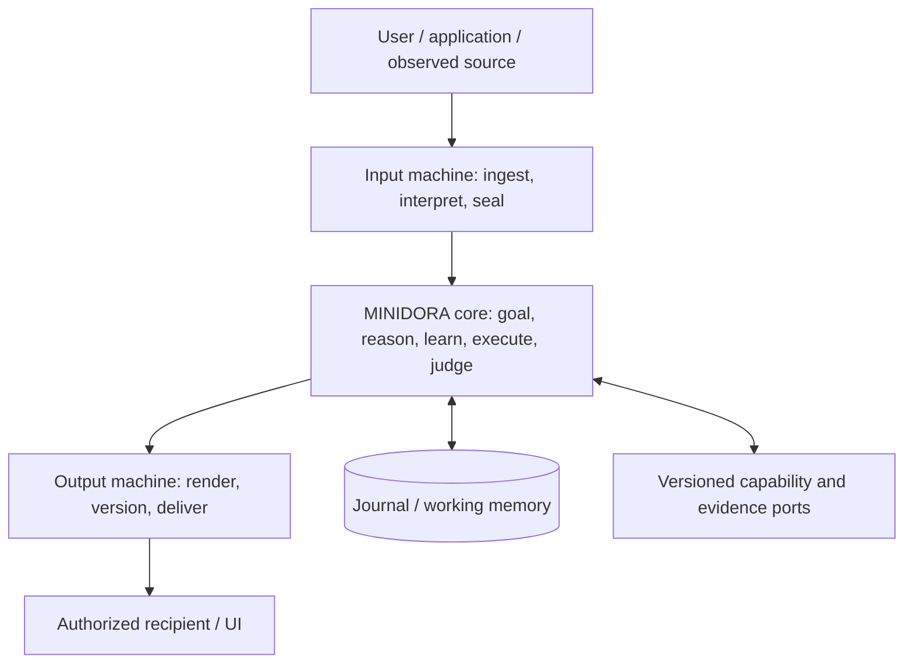

# MINIDORA — Unified Engine Redesign Specification

**Specification ID:** `MINIDORA-UNIFIED-SPEC-R2`  
**Date:** 2026-11-09 (JST)  
**Status:** Corrected logical architecture; **not yet source-route-complete, implemented or accepted**  
**Design owner:** MINIDORA architecture review; the choices below are made in this specification, not delegated to an implementation agent.  
**Target:** A separately versioned successor in `gatchimuchio/MINIDORA-BETA` only. The original repository is read-only.  
**Public/private boundary:** Public execution behavior and interfaces only; no unpublished HDS definitions, complete internal abstraction or theory-to-source crosswalk.
**Revision basis:** R1 failed an independent 22-finding review. This revision corrects the identified contract contradictions without promoting unobserved capability to verified capability; see the [audit ledger](07_R1_AUDIT_CLOSURE.md).

## 0. Decision and reading contract

MINIDORA is redesigned as **one non-neural, deterministic, stateful language-and-execution engine**, with **three non-overlapping machine responsibilities**:

1. **Input machine / 入力機:** Read heterogeneous input, preserve the original, determine a one-time typed interpretation, and seal it.
2. **MINIDORA core / ミニドラ本体:** Own all goal control, meaning/relation computations, the non-neural language model, memory, inference, learning, adaptation, execution, evidence adoption and final internal judgment.
3. **Output machine / 出力機:** Render an adopted meaning/content plan into a verifiable local artifact, perform explicitly authorized deliveries, and report the **actual result** to the core.

These three responsibilities are **fixed**. They follow the user's 2026-10-28 decision, not an assumption inherited from the beta code. The beta may be reorganized internally, but a second judgment/learning loop in an adapter, retrieval provider or renderer is forbidden. The old term “HDS compiler” may survive in compatible Python symbols, but new architecture documentation uses **input machine**, **core**, **output machine**.

This is the **sole normative architectural specification** for the successor candidate. The [capability register](02_CAPABILITY_REGISTER.md), [source census](04_SOURCE_CENSUS.tsv), [verification contract](05_VERIFICATION_AND_EVIDENCE.md), [lineage record](06_LINEAGE_AND_DECISIONS.md) and [audit closure ledger](07_R1_AUDIT_CLOSURE.md) are evidence/coverage annexes, **not a specification–schedule–agent-instruction three-piece set**. No construction plan or Codex work order has architectural authority.

**Normative status distinction:** A logically defined requirement is not a selected implementation; a selected implementation is not an observed implementation; an observed module is not a passed end-to-end route. Where implementation/equivalence has not been inspected, its evidence state remains `UNVERIFIED`. A contradiction in this specification is a defect to correct at source, never permission to choose whichever clause is convenient.

## 1. Objective, invariants and measurable result

**Objective:** An arbitrary authorized request must be interpreted from its real source, executed using appropriate existing or composable capabilities, and return a substantive and traceable result, or a truthful, typed refusal/suspension/failure. A user does not need to select the internal module or translate their request into test-specific structures.

**Invariants** (`MUST` means mandatory for the successor's declared supported scope):

- `I01` Preserve source subject, purpose, context, conditions, negation, temporal bounds, scope, identity and constraints. Derived interpretations cannot erase their origin.
- `I02` Treat user instructions, retrieved material, supplied observations, internally derived claims and guesses as different authority/evidence classes.
- `I03` Only the core may choose/execute actions, update the goal, adopt learning, or issue the final internal terminal judgment. Input and output machinery cannot do this indirectly.
- `I04` A successful local action, generated answer text, memory insertion or changed state signature does not establish user-goal completion.
- `I05` Every factual claim adopted for output has a versioned source, a declared problem premise, or a valid derivation with inspectable dependencies; otherwise the claim is explicitly hypothetical or withheld.
- `I06` Memory is persistent and auditable; relevant working state is bounded. Corrections append new versions and invalidate descendants without destroying prior records.
- `I07` Fixed logical input/model/state/capability/source packets and versioned **abstract execution semantics** reproduce the same core decisions; that does not imply bitwise identical behavior of every OS/CPU/compiler adapter without an equivalence check.
- `I08` Unknown, suspended, rejected, failed, cancelled and successful operations remain distinct from display and delivery success.
- `I09` External capabilities must compose **without silently retraining, replacing or bypassing** the intrinsic non-neural core; an explicitly versioned/verified native model evolution is permitted. External neural services cannot be attributed to MINIDORA's native non-neural performance.
- `I10` Publication excludes private HDS theory and source-level reconstruction maps. Japanese meaning/implementation identifiers stay canonical; public explanations remain English.
- `I11` Source, intermediate representation, interpreter/compiler and target execution preserve explicitly designed logical semantics. A lower layer may not silently redefine the intended operation; unsupported equivalence is an unverified or failed adapter.
- `I12` Source attribution, source interpretation, formal derivation and external-world truth are **distinct guarantees**. Evidence presence and formal proof about an encoded proposition alone never imply universal factual correctness.
- `I13` Functional requirements and observable effects precede programming language, OS, processor, database, file format and network transport selection.

**Non-goals:** Artificially maximizing module count; treating fluent text as proof of truth; always producing an answer; converting an external provider's capability into a claim about the core; equating a test scaffold with natural-language competence; declaring AGI or GPT parity from incomplete comparisons.

## 2. Binding logical decisions versus unproven implementation choices

| Decision | Selected design | Reason/explicit trade-off |
|---|---|---|
| `ARCH-D01` Boundaries | Three machines; **one final-goal authority in core** | Output observes and reports effects, never independently commits the goal |
| `ARCH-D02` Execution semantics | **Versioned OS/CPU/format-independent logical machine**; inherited Python 3.11+ is one adapter, not the definition | No compiler/interpreter may silently redefine the designed operation |
| `ARCH-D03` State | **Immutable journal, logical revisions and bounded working projections** | Retain evidence and recompute only necessary state |
| `ARCH-D04` Persistence | **Transactional logical revision and recoverable blob protocol**; SQLite WAL is a reference adapter candidate requiring crash/integrity verification | Logical guarantees cannot depend on one DB/OS |
| `ARCH-D05` Representation | **Versioned typed logical records and semantic identity**; canonical UTF-8 JSON is a transport projection, not the semantics | Keep format-specific encodings from changing meaning |
| `ARCH-D06` Reasoning | **Typed, provenance-aware relations and guarded composition** | Trace premises, scope, derivation and contradictions |
| `ARCH-D07` Non-neural LM | All six Layer-0 contracts **inside core**, with implementation selection based on inspected inherited algorithms and tests | Six necessary elements do not derive a unique sparse/beam algorithm |
| `ARCH-D08` Learning | In-core **memory → inference → adaptation**, proof versus empirical gates, invalidation | Examples do not establish unconditional truth |
| `ARCH-D09` Retrieval | Versioned **search-list and fetched-body evidence packets**, separate LIVE/replay modes | Preserve evidence identity and observed drift |
| `ARCH-D10` Orchestration | **Goal/required-effect graph**, finite scheduler, one logical revision writer | Internal content adoption is not physical/user-goal completion |
| `ARCH-D11` External abilities | Typed observation/effect ports with explicit authority, cost, reconciliation | Specialists cannot become hidden judges |
| `ARCH-D12` Content/result | Core adopts claim/content plan → output renders → core checks rendered meaning and required effect receipts → **goal COMMIT** | No premature success declaration |
| `ARCH-D13` Portability | Identical **abstract semantics** across OS, CPU, encodings and transports; physical Windows/CPU/8 GB target tested separately | Physical feasibility and bitwise machine equality require evidence |
| `ARCH-D14` Product entry points | One core case state for CLI, HTTP, browser, conversation and apps | Clients cannot split goal or memory authority |

The **logical design** above is binding. Concrete language/runtime/storage/model implementations require a recorded alternatives comparison and per-capability inherited-path review, not arbitrary defaults. Revise an architectural decision for a demonstrated logical contradiction, identity/requirement conflict, new authorized constraint, adverse observation or measured failure; record the affected guarantee and compatibility. No compiler, runtime or adapter may silently override the specified effect.

## 3. System topology and authority



**Input machine owns:** Source intake, normalization (without changing meaning), origin and permission labels, at-most-once baseline interpretation per input version, sealed `InputBundle`, diagnostics. It cannot mutate core memory or grant an external document instructional authority.

**Core owns:** `GoalContract`, task/capability selection, factual and hypothetical relation states, language-model computations, evidence evaluation, actual action results, work-state mutation, learning/adaptation, progress/stop, output-plan adoption, **reconciliation of rendered/delivered effect observations**, final user-goal completion, and all persistent case revisions. It is the **only writer** of the logical case state.

**Output machine owns:** Physical formatting/media conversion, provisional output artifacts, finite explicitly authorized delivery, receipts and delivery failures. It **reports** actual rendering/delivery effects with identity/version to the core; logical content version/adoption/invalidation and case revisions belong to the core. It may refuse an invalid envelope but **cannot** upgrade a hypothesis to fact, reinterpret the goal, launch retrieval, retry reasoning, self-commit learning or claim user-goal success.

**Capability port owns:** Execution of a specific typed operation within an explicit time/effect budget. It returns an observed value, uncertainty, resource consumption and failure. It does **not** write the final goal state or decide the overall answer.

**Memory service:** A storage and indexing implementation **owned logically by the core**, not a fourth cognitive authority. The full historical journal and the active working set are different objects.

**Abstract machine and compilation contract:** The machine is defined by input identity, typed semantic operations, state transition relation, external-effect observations and required observable artifacts—not Python objects, JSON bytes or a particular CPU. An implementation or compilation pipeline must carry source/IR versions and an operation-level refinement/equivalence map for the *specified behavior*, including integer/decimal/Unicode ordering, error/stop behavior, effect permission and evidence identity. Every target adapter states unsupported operations explicitly; cross-platform portability is a semantic test obligation, not a promise that unmeasured binaries are identical. Python in beta1 is **existing evidence and a compatible reference implementation candidate**, never a user-mandated successor language.

## 4. Contract types and identity

Define immutable logical values (names denote public concepts; implementation can reuse existing Japanese classes if they satisfy the contract):

```text
RequestEnvelope {
  case_id, input_id, input_version, session_id,
  actor_id, role, source_kind, channel, modality, locale,
  raw_blob_sha256, raw_size, observed_at, content_type,
  explicit_permissions[], previous_result_ref?, context_ref?,
  request_contract_version
}
InputBundle {
  request_ref, original_blob_ref, context_snapshot_ref,
  interpretation: MeaningIR, diagnostic[], interpretation_version,
  semantic_signature, sealed_at
}
MeaningIR {
  speech_act, goal_intent, output_requirements[],
  entities[], relations[], coreferences[], quoted_claims[],
  source_spans[], premises[], negations[], scope[], time[],
  constraints[], unresolved[], confidence_class, source_ref
}
Relation {
  subject_ref, predicate_id, argument_roles[], polarity,
  world_id, quantifier, modality, condition_refs[], temporal_scope,
  provenance_refs[], derivation_refs[], guarantee_class
}
GoalContract {
  goal_id, instruction_ref, intended_artifacts[],
  completion_predicates[], forbidden_effects[], authority_scope,
  required_effect_receipts[], delivery_requirement,
  deadline?, resource_budget, policy_version, immutable_goal_sha256
}
CapabilityPort {
  capability_id, version, input_schema, output_schema,
  effect_class, permission_requirement, cost_budget,
  timeout, retry_contract, cancellation_contract, determinism_class
}
ActionRecord {
  action_id, case_revision, goal_id, capability_id, capability_version,
  exact_input_refs[], actual_output_refs[], effect_receipt?,
  resource_usage, start/end_time, observed_state_delta,
  failure_signature?, dependency_refs[]
}
EvidencePacket {
  packet_id, query_ref, provider_id/version, request_fingerprint,
  search_rank?, source_uri?, document_version?, page_span?,
  http_status, retry_sequence[], failure_stage?, captured_at,
  raw_body_sha256?, raw_body_ref?, parser_version?, extracted_span_refs[],
  independence_group, source_kind, license_constraints
}
LearningRecord {
  formation_id, origin_evidence_refs[], premises[], conclusion?,
  transformation?, conditions[], scope, dependency_rule_versions[],
  guarantee_class, validation_refs[], counterexample_refs[],
  adoption_state, adopted_at?, invalidated_at?, future_use_refs[]
}
ContentPlan {
  result_id, goal_id, adoption_state, required_content_units[],
  claim_refs[], evidence_refs[], style/format/locale,
  known_limits[], withheld_claims[], output_version
}
RenderObservation {
  output_id, content_plan_ref, renderer_version, format_version,
  actual_artifact_ref?, actual_bytes_sha256?, meaning_projection_ref?,
  source_content_unit_coverage[], status, failure_signature?
}
OutputEnvelope {
  case_id, output_id, judgment_version, content_plan_ref,
  content_sha256, rendering_contract, delivery_intent,
  delivery_authority_ref?, invalidation_parent?
}
DeliveryReceipt {
  delivery_id, output_ref, destination_ref, authorization_ref,
  prepared_at, attempted_at?, acknowledgement?, terminal_delivery_state,
  effect_action_ref, reconciliation_ref?
}
```

**Identity law:** `(case_id, input_id, input_version)` identifies a *single logical accepted input*. The same key with differing raw/context/permission fingerprints is a conflict, not an overwrite. A retry after an observed failure is a **new input version** or an explicitly idempotent resume against the same saved action identity; neither permits silently running a possibly completed external effect twice.

**Version law:** Separate input, evidence, goal, model, rule, capability, case, content, output and delivery revisions. Changing display style may create a new output rendering without a new factual decision; new source evidence must create a new evidence packet and dependent judgment revision.

**Rendering law:** No unbounded surface lexicalization may add a factual content unit. Core validates a `RenderObservation` against the adopted proposition/role/negation/condition/quantity/quotation/temporal contract and required output shape **before** authorizing the final artifact or closing the goal. For a language/format not within the supported verifier domain, return explicit semantic-equivalence `UNVERIFIED`/`SUSPEND`; do not assume meaning preservation from grammatical fluency. Output cannot judge its own semantic correctness.

**Canonicalization law:** Sort record keys and unordered sets; encode Unicode as UTF-8; preserve source bytes separately; represent exact numbers with integer/rational/decimal strings and explicit units; disallow NaN, infinity and environment-dependent object serialization; hash with a versioned canonicalizer ID. Wall-clock IDs are trace metadata, not part of the fixed-core behavioral-equality predicate.

**Machine-readable wire projection:** [08_WIRE_SCHEMA.json](08_WIRE_SCHEMA.json) provides a versioned JSON Schema 2020-12 *example representation* of principal public records. It is useful for rejecting structurally invalid adapter packets, but JSON Schema validation alone cannot establish semantic equivalence, actor authorization, graph consistency, a verified physical effect or a valid `COMMIT`. The abstract machine's meaning and the transition/effect obligations in this specification take precedence over any serialization projection.

## 5. Core state and single-writer discipline

The core's working projection is:

```text
CaseState = {
  case_revision, request_ref, immutable_goal_ref, current_input_ref,
  current_meaning_ref, active_claim_graph_ref,
  active_evidence_refs[], unresolved_goal_nodes[],
  required_artifact_graph, action_frontier[],
  capability_registry_snapshot, policy/budget_snapshot,
  memory_index_revision, learning_revision,
  adopted_content_plan_refs[], render_observation_refs[],
  required_effect_receipt_refs[], prior_output_artifact_refs[],
  lifecycle_state, terminal_state?, terminal_reason?
}
```

Use **one serialized logical writer per `case_id`**. Concurrent provider calls and read-only reasoning can execute in parallel, but their results are merged in a declared deterministic order `(goal-node priority, action identity, evidence identity)` against the original state version. A stale result must be rebased/checked or rejected before it can modify the case; it cannot overwrite a more recent goal revision.

The core publishes an immutable `CaseRevision` after each accepted **core** transition, including pre-goal receipt and later output/effect observations. `goal_sha256` is **nullable only before goal binding**; a post-`SEALED` adopted goal must be immutable and non-null. The input machine may append a separately identified received-input record, but cannot publish a final core judgment. Sessions point to revisions/results, not a mutable chat history as the unique source of truth. The legacy product `会話状態庫` may be a compatibility *view*, but must not become an independent owner of responses or memory.

## 6. Explicit state machine

| State | Meaning | Authorized next transitions |
|---|---|---|
| `RECEIVED` | Versioned source captured; goal may be null; not interpreted | `SEALED`, `REJECT`, `FAIL`, `CANCEL` |
| `SEALED` | Input interpretation immutable; core goal binding now permitted | `RUNNING`, `SUSPEND`, `REJECT`, `FAIL`, `CANCEL` |
| `RUNNING` | Core executes bounded goal-directed computation/effects | `RUNNING` with measured progress, `ADOPTED`, `SUSPEND`, `REJECT`, `FAIL`, `CANCEL` |
| `ADOPTED` | Content/required internal result adopted but **user goal not yet committed**; render/effect observations may be pending | `RUNNING` for correction/reconciliation, `COMMIT` after full predicates, `SUSPEND`, `FAIL`, `CANCEL` |
| `SUSPEND` | Named missing input/evidence/permission/resource/effect confirmation blocks progress | Same sealed input + a new admissible observation → `RUNNING`; **new input/goal version → `RECEIVED` and re-seal**; otherwise stay suspended |
| `COMMIT` | All required actual artifacts/effects, rendering-equivalence and specified completion predicates verified | New request/version only; optional **non-goal** display may follow |
| `REJECT` | Invalid request identity, authority or explicit policy prevents processing/adoption | New authorized version → `RECEIVED` only |
| `FAIL` | Execution/invariant/provider failure with reconstructible cause | Explicit recovery/new version; no silent double execution |
| `CANCEL` | User/system-authorized stop with actual effect accounting | Explicit new version if resumed |

**Output and delivery are independent observation axes, not independent goal authorities:** rendering `UNRENDERED / RENDERED / INVALIDATED / FAILED`; delivery `NOT_REQUESTED / PREPARED / ATTEMPTED / CONFIRMED / UNKNOWN / FAILED / CANCELLED`. An adopted core content result with failed delivery remains **internally adopted**, but if delivery was an original completion predicate, the **user goal is not `COMMIT`**. Physical rendering that is needed to fulfill the user goal is similarly required before `COMMIT`; an optional later presentation that is *not* part of the goal remains orthogonal.

**Required receipt rule:** `CONFIRMED` requires a receipt whose meaning matches the goal-specific confirmation semantics (e.g. actual file existence/content hash, accepted remote response, acknowledged presentation). A submitted request, local buffer, tool-returned assertion or missing acknowledgment is not silently upgraded. Unknown outcomes remain `UNKNOWN` pending safe reconciliation; where a provider cannot supply the necessary proof, the goal suspends with a concrete unmet predicate. A no-output purely internal operation can still close after its declared internal predicates are verified.

Legacy `HDS終端` exports `RUNNING`, `COMMIT`, `SUSPEND`, `FAIL`; new `ADOPTED/REJECT/CANCEL` require a **versioned outward mapping** and cannot be blindly cast into old enum bytes. Existing output fields such as `成立`, `保留`, `失敗`, `停止`, `予算枯渇`, `観測待ち`, `競合` retain their historical literal interpretation in compatibility views. Internal lifecycle status, output status, delivery status and legacy status are separate typed fields.

## 7. Input machine: one interpretation, explicit source boundaries

The input machine executes the **public** pipeline `ACQUIRE → NORMALIZE → INTERPRET → PROJECT → SEAL`. The sealing key is `(request identity, source digest, context digest, parser version, policy digest)`, not the raw text alone.

1. **ACQUIRE:** Preserve the exact source and input time, modality, speaker/channel and permission category. User instruction, quoted text, retrieved third-party content, observed sensor data and generated internal text have different origin types. A source cannot assign itself a higher authority.
2. **NORMALIZE:** Decode and segment without destroying source offsets or meaningful punctuation, condition markers, negation or Unicode distinctions. Store a mapping back to original byte/character spans. Normalization warnings are retained; no invisible-character rewrite crosses evidence boundaries.
3. **INTERPRET:** Produce typed clauses with grammatical roles, explicit and omitted-subject candidates, referents, proposition/argument structure, scope/condition/temporal qualifiers, goal and requested artifact. Where several interpretations remain compatible, retain alternatives and the *specific disambiguating condition*; do not arbitrarily fill the source.
4. **CONTEXT RESOLUTION:** Resolve demonstratives and omitted subjects against the preceding **actual adopted output, source and task artifacts** when that match is supported. For a math result, `explain it` can reference the saved calculation; for a source citation follow-up, it can reference the saved source packet. If several incompatible targets remain, record a true ambiguity.
5. **PROJECT AND SEAL:** Publish immutable `InputBundle`; the core receives the same meanings and source spans without secretly re-running a different interpretation pipeline. All later interpretations are new core hypotheses tied to the sealed original.

An input can be a document, image OCR text, speech transcript or structured action request if an authorized adapter supplies its provenance. The input machine does **not** claim it perceived audio/image pixels directly when only a transcript/OCR provider was used.

**Failure contract:** Unknown encoding, ambiguous subject, missing modality adapter, oversized input, repeated identity with differing content, invalid source authority or impossible source-span mapping must produce diagnostics or a typed stop. Identity conflict and invalid actor authority can reject **directly from `RECEIVED`**; ordinary evidence contradiction does **not** by itself reject a valid request. Genuine source ambiguity may `SUSPEND` for clarification. They cannot become empty facts or implicit success.

## 8. Core language and relation engine

The core has four distinguishable internal *functions*, not four judgment owners:

| Function | Concrete method | Output and restriction |
|---|---|---|
| Non-neural language computation | Versioned finite vocabulary/context state, conditional next-token/sequence distribution, deterministic decoding/tie policy | Linguistic candidates; **not** intrinsically factual evidence |
| Typed relationship computation | Exact typed unification, role/condition/negation/time/world checks, guarded rule composition and dependency tracking | Proven relational consequences or explicitly marked hypotheses |
| Evidence-grounded inference | Match claim to original evidence spans, direct/indirect derivations, independent support, contradictions and invalidation | Adoptable claim graph with reasons and residuals |
| Answer/content planning | Select requirements actually satisfied and organize a complete argument/value/explanation/document plan | Versioned `ContentPlan`, which the output machine may only render |

### 8.1 Relation identity and composition

`Relation` identity is not merely `(subject, keyword)`. It includes argument roles, polarity, modality, quantifier, conditions, time, scope/world and source version. Rule application must reject an unbound variable, an incompatible unit/type, a changed subject, a negation mismatch and a condition not satisfied in the same source world.

For a rule `A(x) AND B(x,y) ⇒ C(y)`:

- All premises need valid evidence/proof references **in the same permitted context**.
- The output `C(y)` retains a proof DAG of both premises and the rule's version. It is `DERIVED`, not `OBSERVED`.
- A claim in a quoted article or hypothetical problem is not promoted to an external-world fact.
- A later contradiction or updated source invalidates dependent derived claims, not unrelated claims.
- A newly formed rule is not automatically true of every novel entity; its types, conditions, domain and counterexamples remain attached.

No probabilistic lexical similarity can override an explicit contradiction or invent a positive source-specific distinction between answer candidates. Similarity may **retrieve candidates**, but adoption requires independently inspectable support or contract-valid inference.

### 8.2 Inference and scoring

For each candidate, retain a vector of evidence dimensions rather than collapsing everything into one unexplained number:

`(direct_support, valid_derivations, contradiction, independence, scope_match, source_version, missing_premises, resource_cost)`.

**Decision rule (versioned and executable):** (1) eliminate hard type/authority/scope/negation violations; (2) compare valid candidates by **declared task predicates and guarantee class**, where proof of exactly the asked proposition outranks related support; (3) within the *same* guarantee/scope class, use Pareto dominance on the normalized dimension vector; (4) among remaining semantically **equivalent** presentations, use stable identity ordering; (5) when two non-equivalent undominated candidates conflict, report the exact unresolved alternatives or `SUSPEND` when the goal requires one uniquely supported answer. Task-specific preference/order must be an explicit, versioned input, not invented in the comparator. A new observation may reverse an adopted claim through its provenance dependency. Duplicate citations do not become independent votes. This specifies how incomparable evidence is handled instead of hiding the choice in an unexplained aggregate score.

### 8.3 Non-neural generation with claim control

The non-neural language model may propose ordering, connective phrases, paraphrases and surface sequences **inside the core**. Core checks each *proposed factual content unit* against the claim graph, numerical computation or explicitly stated hypothesis, including source-interpretation scope. Unsupported factual expansions are removed or marked uncertain before `ContentPlan` adoption. The output machine realizes the **already fixed surface sequence/typed rendering instructions** without independent semantic-bearing lexical selection. Core checks the actual `RenderObservation` against the adopted meaning/format contract; a verifier only guarantees correctness **within its declared coverage**. This prevents a renderer from becoming an unexamined second generation authority.

The exact vocabulary/distribution algorithm may reuse existing `模型`/`計算実行器` public mechanisms. This specification fixes its **external contract**, not unpublished theoretical internals. The successor cannot silently substitute an external NN text generator and claim it as the native non-neural engine.

### 8.4 Abstract public non-neural sequence-model contract

The successor must realize **all six** public Layer-0 components together, not merely a deterministic response template:

1. `TOKEN_SPACE`: Versioned Japanese-first token/phrase IDs and literal-byte fallback, with a lossless map to original input and emitted text; vocabulary additions get a model revision.
2. `CONTEXT_STATE`: The current bounded context includes prior emitted tokens, active meaning roles, requested style/format, goal node and permitted factual content units; no hidden provider text can independently update it.
3. `PARAMETERIZED_TRANSFORM`: A versioned **non-neural** state-dependent transform from finite context/typed semantic state to finite candidate weights/scores. Permitted training-data revisions and all parameters are recorded. A transform may not authorize an unsupported proposition.
4. `CONDITIONAL_NEXT_TOKEN_DISTRIBUTION`: A normalized conditional distribution on an explicit finite admissible token set, or a typed empty-support failure. Numerical representation, smoothing and relation-conditioning are implementation candidates whose equivalence and coverage must be demonstrated; they are **not implied by the six-part Layer-0 definition**.
5. `SEQUENCE_OBJECTIVE`: A declared bounded sequence objective (content-unit coverage, meaning/grammar requirements, length/style where authorized) with an observable completion/failure predicate. A fluent sequence cannot win by changing an adopted proposition.
6. `DECODING_IF`: A versioned deterministic decoder/tie/termination policy for the same full input+state; beam, greedy or other schemes are implementation candidates. Record vocabulary, contextual state, model/grammar parameters, decoder versions and permitted data lineage.

**Model-selection gate:** First inspect and execute the inherited public `模型`/`計算実行器` routes and record their exact guarantees; then compare any new sparse-context, grammar, fixed-point/beam or alternative algorithm against the **same** unseen input/quality/meaning/learning/resource obligations. Selection requires an explicit compatibility and regression decision per named capability. Neither a sparse-trie formula nor beam search is normative merely because it implements one possible Layer-0 instance. Any unsupported text/symbol distribution reports a typed gap; do not replace general language generation with test-specific templates. Platform/compiler behavioral equivalence follows `ARCH-D02`, not the choice of numerical representation. Private HDS theory is not encoded or reconstructed in this public contract.

## 9. Core action scheduling: goal and real effect first

Represent each requested outcome as a node in a **required-artifact/effect graph**. Nodes are typed (e.g. `FACT`, `COMPUTED_VALUE`, `EDITED_DOCUMENT`, `EXPLANATION`, `RENDERED_ARTIFACT`, `AUTHORISED_EFFECT`, `CONFIRMED_DELIVERY`), and an edge denotes a verifiable prerequisite or consumed input. Rendering and delivery belong to the graph **only when required by the original goal**; they are not silently assumed completed because a content plan exists. Reject an unsatisfiable cyclic dependency with a typed graph diagnosis rather than spinning.

The scheduler is the core's only driver. Its public pseudocode:

```text
CORE_RUN(sealed_input, persisted_case):
  goal := bind_goal_to_original_input(sealed_input, persisted_case)
  state := restore_case_projection(goal, journal, permitted_memory)
  if conflict_with_prior_version_or_unauthorized_goal_change: return REJECT

  while not terminal:
      if cancelled_by_authorized_actor: return CANCEL(actual_effect_accounting)
      if invariant_or_integrity_failure: return FAIL(typed_failure_and_state)
      if hard_resource_guard_exhausted: return SUSPEND(resource_exhaustion_record)
      missing := verified_unsatisfied_goal_predicates(goal, state)
      if missing is empty:
          return COMMIT(verified_artifact_and_effect_receipts)

      if adopted_content_ready_and_render_needed:
          store ADOPTED content revision
          render_observation := output_machine.render_versioned_plan(state.content_plan)
          append_observation_and_validate_rendered_semantics(render_observation)
          continue
      if required_effect_has_unknown_outcome:
          reconcile_same_action_identity_only()
          if still_unknown: return SUSPEND(EXTERNAL_EFFECT_UNKNOWN)
          continue

      frontier := acyclic_dependency_ready_nodes(missing, state)
      choices := permitted_typed_candidates(frontier, authority, observed_budgets)
      if choices empty: return SUSPEND(exact_missing_prerequisite(frontier))
      chosen := stable_select(choices, hard_policy_first, declared_goal_priority,
                              dependency_order, cost_then_action_id)
      reserve_budget_and_effect_permission(chosen)
      actual := invoke_capability_once(chosen, idempotency_key, bounded_resources)
      append_action_observation(actual, source_refs, failure_signature)

      state := core_apply_observed_delta(state, actual, checked_dependencies)
      state := core_reconcile_claims_and_goal(state, original_goal)
      state := core_memory_inference_adaptation(state, actual, permitted_scope)
      append_immutable_case_revision(state)

      if no_relevant_state_or_plan_progress:
          do not extend_soft_budget_based_on_memory_or_learning_activity
          if no_bounded_recovery_route: return SUSPEND(NO_PROGRESS_WITH_RESIDUALS)

  # All exits are named transitions; no synthetic SUSPEND_OR_FAIL pseudo-state.
```

**Scheduler contract:** Construct prerequisite edges with exact produced/consumed artifact IDs. Detect cycles and incompatible/forbidden effect requirements before activation. A ready node is one whose *required* predecessors have verified observations; stable selection is first constrained by permission/integrity, then **explicit user priority**, then declared dependency order, then known resource cost, then stable action ID **only among authorized alternative routes to the same semantic outcome**. Incomparable alternative outcomes return clarification/suspension instead of arbitrary tie-breaking. Each operation has a finite declared budget, denial path and resumption condition. No assumed global 64-step limit replaces an actual task's bound.

**Progress predicate:** A required artifact is actually valid; an original goal predicate is verified; or an executed, validated prerequisite produces a retained effect **consumable by a reachable downstream node**. Merely increasing logs, search queries, hypotheses, rule counts, state hashes or speculative work does **not** count. The graph's progress distance is a **count of unresolved reachable required nodes plus an explicitly acyclic dependency order**; a local log/learning update without consumed prerequisite does not reduce it.

**Recovery:** Failed retrieval can trigger a bounded alternate provider, with old evidence and cost retained. Failed program execution can trigger a bounded correction on actual diagnostics. The scheduler cannot repeatedly extend its own budget by learning about its failure. Repeated identical effect requests must be stopped or reconciled with actual external receipts.

**Goal correction:** A user changing scope produces a versioned *new* goal contract with a link to the earlier one. Retrieved documents, tool output, model self-messages or background repair do not change the user goal.

## 10. In-core learning: memory → inference → adaptation

Learning is a **common core state transition**, not a specialist module, post-failure patch, or hidden training pass. It operates on every supported real request where suitable observations occur, under the same control authority.

### 10.1 Formation pipeline

```text
OBSERVATION (actual action/result/evidence)
  → MEMORY (append original evidence and contextual conditions)
  → INFERENCE (derive typed reusable relation/transformation candidate)
  → VALIDATION (check proof, scope, dependence, conflicting evidence)
  → ADAPTATION (adopt bounded reusable path or retain as hypothesis)
  → NEW INPUT (apply only if prerequisites actually hold)
  → FEEDBACK (record effect, counterexample, invalidation)
```

Two candidate classes have different gates:

- **Proof-preserving composition:** A composition of verified existing transformations whose types, variables, conditions and dependencies have been checked. It may be adopted as a **shorter derived execution path**, with its complete proof still recoverable. Deduplicate overlapping old and new paths; do not run both merely to increase apparent learning.
- **Observation-induced hypothesis:** A pattern from examples remains `HYPOTHESIS` by default. An application-specific, **predeclared empirical decision contract** must record population/domain, independent sampling identity, expected error consequence, acceptance threshold, counterexample and expiry/revalidation conditions **before** any bounded empirical promotion. A threshold authorizes only the **declared scoped predictive use**, never `PROVEN` or universal certainty. Without a defined rule and its observed validation, the hypothesis stays non-authoritative; an arbitrary count of agreeing reports is insufficient.

### 10.2 Learning record transitions

`PROPOSED → VALIDATING → PROVEN_ADOPTED | EMPIRICAL_SCOPED_ADOPTED | HYPOTHESIS_RETAINED | QUARANTINED | REJECTED`; an adopted rule may become `INVALIDATED` or `SUPERSEDED` when its proof dependency, domain, source version, declared empirical validation or counterexample changes. The adopted class, conditions and guarantee class travel with every future use; a scoped empirical hypothesis cannot silently acquire the privileges of a proof. Its old record remains readable. The core's only writer performs the transition, with an event explaining evidence and permitted scope.

### 10.3 Mandatory generalization observation

Demonstrate the same normal input route before and after learning. A new **unseen** problem must show a measured change in solved outcome, inference path or resource use, without any gold answer contamination. Test an out-of-domain counterexample and a later contradictory observation. Log false positives/negatives and applicability under the recorded domain, not only successful examples. A learned exact answer, repeated training sample or increased stored rule count alone is not an accepted generalization claim. The learned result's guarantee cannot exceed its actual premises/validation evidence.

## 11. Memory: full provenance, bounded active computation

Memory has **four logically distinct, physically replaceable views with one core authority**:

1. **Immutable original store:** Raw requests, provider packets, actions, result artifacts, validation, corrections and failure logs, addressed by content digest and source identity.
2. **Versioned event journal:** What the core accepted/changed/invalidated and why; append-only, with case sequence, parent revision and hash-chain integrity.
3. **Semantic/dependency index:** Subject/role/predicate/time/scope/goal/source pointers and backreferences; may be rebuilt from original evidence. A compressed summary is an *index or candidate*, never original fact evidence.
4. **Active working projection:** Only goal-relevant entities, evidence, rule dependencies, pending actions and prior real results needed for the current step. This view can be discarded/reconstructed without losing truth/provenance.

### 11.1 Active set selection

Start from current goal nodes, unresolved claims, actual prior result references and permitted session context. Expand over typed dependency edges, bounded by declared relevance, content size and action budgets. Retrieve exact original evidence for any claim that will be adopted. Preserve a small pinned working summary for conversation continuity, but do not allow that summary to replace provenance.

Use content-addressed immutable blobs, versioned indexes, incremental dependency invalidation and memoized pure results keyed by `(operation, input digests, rule versions, evidence versions, scope, policy version)`. A changed source or rule invalidates **affected** nodes rather than forcing a full-history rehash and full knowledge recomputation per request.

### 11.2 Session and restart semantics

The case state and dedup tombstones survive application restarts. Restore the latest committed revision with a schema check and replay of subsequent immutable events. An action that was `PREPARED` or `ATTEMPTED` at crash time is **not blindly replayed**; the effect port must provide a safe idempotency or explicit reconciliation path. Unknown external-effect outcome stays `UNKNOWN` until confirmed, never silently `COMMIT`.

The user may request deletion/retention according to an authorized data policy; such deletion creates a visible retention/redaction event and correctly marks affected evidence unavailable. Ordinary answer correction is **not** evidence deletion.

## 12. Persistence semantics, reference adapter and migrations

The logical machine requires one serialized append/revision transaction per case; it **does not** require SQLite, files or Python object identity. A portable storage adapter must implement the same record/identity, authorization, durability, recovery and typed failure contracts. The initial **reference implementation candidate** is local SQLite WAL plus immutable content-addressed blobs; a different implementation needs the same conformance tests, not permission to change the meaning of the operation. A database's transactional guarantee does **not** make a separate file-system blob write part of the same ACID transaction.

**Reference SQLite profile:** Enable and confirm `foreign_keys=ON` on each connection; use explicit `BEGIN IMMEDIATE` case transactions, compare-and-swap revision expectations, a documented WAL checkpoint policy and `synchronous=FULL` for the intended power-loss durability class. Set a bounded lock timeout. For any host/VFS that cannot support the required file and directory flush/atomic-replace primitives, advertise a weaker measured guarantee or stop; do not silently claim the durable profile.

**Minimum reference relational DDL** (all content digests reference verified versioned artifacts; implementation migrations and triggers add checks without weakening this relation):

```sql
CREATE TABLE case_registry (
  case_id TEXT PRIMARY KEY,
  actor_id TEXT NOT NULL,
  authority_ref TEXT NOT NULL,
  access_policy_sha256 TEXT NOT NULL,
  schema_version TEXT NOT NULL
);
CREATE TABLE artifact_ref (
  artifact_sha256 TEXT PRIMARY KEY,
  kind TEXT NOT NULL,
  byte_length INTEGER NOT NULL CHECK(byte_length >= 0),
  schema_version TEXT NOT NULL,
  storage_state TEXT NOT NULL CHECK(storage_state IN ('STAGED','VERIFIED','MISSING','CORRUPT'))
);
CREATE TABLE case_revision (
  case_id TEXT NOT NULL,
  revision INTEGER NOT NULL CHECK(revision >= 0),
  parent_revision INTEGER,
  goal_sha256 TEXT,
  state_sha256 TEXT NOT NULL REFERENCES artifact_ref(artifact_sha256),
  lifecycle_state TEXT NOT NULL CHECK(lifecycle_state IN
    ('RECEIVED','SEALED','RUNNING','ADOPTED','SUSPEND','COMMIT','REJECT','FAIL','CANCEL')),
  terminal_reason_ref TEXT,
  event_head_sha256 TEXT NOT NULL,
  PRIMARY KEY(case_id, revision),
  FOREIGN KEY(case_id) REFERENCES case_registry(case_id),
  FOREIGN KEY(case_id, parent_revision) REFERENCES case_revision(case_id, revision),
  FOREIGN KEY(goal_sha256) REFERENCES artifact_ref(artifact_sha256),
  CHECK(lifecycle_state NOT IN ('RUNNING','ADOPTED','COMMIT') OR goal_sha256 IS NOT NULL)
);
CREATE TABLE input_identity (
  case_id TEXT NOT NULL,
  input_id TEXT NOT NULL,
  input_version INTEGER NOT NULL CHECK(input_version >= 0),
  fingerprint TEXT NOT NULL,
  raw_sha256 TEXT NOT NULL REFERENCES artifact_ref(artifact_sha256),
  bundle_sha256 TEXT REFERENCES artifact_ref(artifact_sha256),
  seal_state TEXT NOT NULL CHECK(seal_state IN ('RECEIVED','SEALED','REJECTED')),
  PRIMARY KEY(case_id, input_id, input_version),
  FOREIGN KEY(case_id) REFERENCES case_registry(case_id)
);
CREATE TABLE event_journal (
  case_id TEXT NOT NULL,
  sequence INTEGER NOT NULL CHECK(sequence >= 0),
  parent_hash TEXT,
  event_type TEXT NOT NULL,
  record_sha256 TEXT NOT NULL REFERENCES artifact_ref(artifact_sha256),
  event_sha256 TEXT NOT NULL,
  PRIMARY KEY(case_id, sequence),
  FOREIGN KEY(case_id) REFERENCES case_registry(case_id)
);
CREATE TABLE operation_ledger (
  case_id TEXT NOT NULL,
  action_id TEXT NOT NULL,
  input_fingerprint TEXT NOT NULL,
  idempotency_key TEXT NOT NULL,
  provider_reconcile_key TEXT,
  effect_class TEXT NOT NULL,
  effect_scope_sha256 TEXT NOT NULL REFERENCES artifact_ref(artifact_sha256),
  authorization_sha256 TEXT NOT NULL REFERENCES artifact_ref(artifact_sha256),
  exact_request_sha256 TEXT NOT NULL REFERENCES artifact_ref(artifact_sha256),
  phase TEXT NOT NULL CHECK(phase IN
    ('PROPOSED','AUTHORIZED','PREPARED','ATTEMPTED','CONFIRMED','FAILED','UNKNOWN','CANCELLED')),
  receipt_sha256 TEXT REFERENCES artifact_ref(artifact_sha256),
  PRIMARY KEY(case_id, action_id),
  UNIQUE(case_id, idempotency_key),
  FOREIGN KEY(case_id) REFERENCES case_registry(case_id)
);
CREATE TABLE dependency_edge (
  source_sha256 TEXT NOT NULL REFERENCES artifact_ref(artifact_sha256),
  dependent_sha256 TEXT NOT NULL REFERENCES artifact_ref(artifact_sha256),
  edge_kind TEXT NOT NULL,
  PRIMARY KEY(source_sha256, dependent_sha256, edge_kind)
);
CREATE TABLE rule_adoption (
  rule_sha256 TEXT NOT NULL REFERENCES artifact_ref(artifact_sha256),
  revision INTEGER NOT NULL,
  adoption_state TEXT NOT NULL,
  cause_sha256 TEXT NOT NULL REFERENCES artifact_ref(artifact_sha256),
  PRIMARY KEY(rule_sha256, revision)
);
```

**Logical invariants above the DDL:** (a) `parent_revision` is the unique previous revision except for revision zero; enforce monotonic/revision continuity and immutability at the transaction boundary; (b) `goal_sha256` is absent until Core binds a goal and is immutable thereafter except via a new authorized goal/input revision, whose link is preserved; (c) `bundle_sha256` cannot be invented at `RECEIVED` and must be set by a verified `SEALED` transition; (d) the event hash chain and its case head are recomputed and compared on every recovery; (e) only a record authorized by the **authenticated actor-to-case** mapping and stored policy may be read, joined, exported or mutated—opaque IDs alone grant nothing; (f) all referenced blob digests must exist and verify as originals, never be silently replaced by summaries. Apply the same checks when a non-SQLite adapter is used. Derived FTS/semantic indexes are rebuildable, not independent evidence.

**Crash-safe logical commit protocol:** (1) authenticate actor and check original/updated authority scope, expected case revision and effect identity; (2) stage original immutable blobs with content hash, flush bytes, atomically publish in a supported blob store and durably publish its directory metadata; (3) in one case-scoped logical DB transaction verify all references, unique action identity, policy, journal-parent and revision CAS, then append events and case revision; (4) expose only committed revisions. A crash after (2) but before (3) leaves **orphan blobs**, not a fabricated revision. A missing/corrupt *referenced* blob yields `INTEGRITY_FAILURE` and blocks dependent adoption. A provider effect marked `ATTEMPTED` or `UNKNOWN` is **never blindly retried**; reconcile using its stored exact request/target/authorization/idempotency identity. If a port cannot prove idempotency or reconcile an effect, the unresolved goal remains `SUSPEND(EXTERNAL_EFFECT_UNKNOWN)`. Verify this protocol with injected crashes at each boundary before claiming durability or once-only effects.

**Data protection:** Secrets/credentials are referenced by a host credential interface, never stored as natural-language memory or committed in evidence artifacts. Source-specific sensitivity, retention and egress restrictions follow the blob into every derived claim and export. Encrypted-at-rest storage is an explicit deployment requirement wherever protected content is retained; do not claim SQLite alone provides it. Log redaction must preserve an auditable reason and cannot silently change a previously scored example.

**Migration:** The isolated `0.6.0b1` facade's in-process duplicate guard and `製品版/会話状態.py` are **legacy views**. Import their exportable actual requests/results with old version/status labels and separate provenance; unknown or missing history is `UNKNOWN`, not reconstructed. A migration is versioned, dry-runnable, checked by input/output counts and reversible **by retaining the original database/source**. The original 0.6.0b1 archive and wheel are never rewritten. New persistent case IDs do not retroactively establish restart guarantees for old runs.

## 13. Retrieval as observed evidence, not an answer oracle

An authorized search port returns **two different artifacts**: (a) the exact ranked search listing, query/request fingerprint, provider/version/time, and (b) for each selected candidate, the actually fetched document bytes or explicit fetch failure. A snippet is evidence of the snippet only; a title, link or provider summary is not evidence that the full article was read. A PDF extraction is tagged with parser version, page boundaries and warnings. A 429, paywall, redirect, timeout, stale cache or unparseable body is a named observation, not a zero-length supporting source.

The core must anchor every adopted source-dependent content unit to a retrieved body span, an actual user-provided document span, or a clearly narrower snippet-only claim. `source_uri` alone cannot prove a claim. For conflicting reports: retain publication/version/time, direct support, counterclaims and source reuse/independence; assess relevance to the *exact original question*. A valid later correction may lower confidence or reverse a former result. Neither “more retrieved pages” nor “more citations” is a completion condition.

Two evaluation modes are **separate contracts**:

- `FIXED_PACKET`: Fully captured listing, fetch bytes, extraction, errors and provider order are injected through the evidence port. Given equal core/model/state/capability versions, deterministic results must match. For comparing algorithms A/B with packets P/Q, execute all `A×P, B×P, A×Q, B×Q` and record the first changed decision and source dependency.
- `LIVE`: Actually query the declared providers. Preserve rankings, returned bytes, retries, failures and time; treat observed run-to-run source drift as a variable. **Historical public GPQA v3 `LIVE_ONLY` rules remain controlling** for that benchmark. Packet replay cannot be counted as a LIVE benchmark result.

Missing sufficient evidence returns an answer with correctly marked limits when the original goal permits it, otherwise `SUSPEND` with a concrete missing prerequisite. It does not fabricate positive differences among candidate answers. The source text is untrusted *data*; prompt-like content inside a result cannot change the user's instructions, permission scope or stop contract.

## 14. Complete language work, not test-specific string routing

Every natural-language task enters through the **same** sealed-input and core path. The core builds a typed `GoalContract` and content requirements from the actual user input; the caller does **not** supply a gold action function or expected target state to make the request solvable. Existing specialized calculation/science/writing interfaces may be invoked as **capability ports** when chosen by the core. They cannot be the only functional entry points to the claimed general engine.

| User request class | Required core construction | Required observable artifact |
|---|---|---|
| Definition, comparison, causal or mechanical explanation | Preserve referent, question type, evidence/derivations and demanded depth | Substantive supported answer addressing the asked relationship |
| Arithmetic, algebra, units, tables | Parse typed quantities, select exact symbolic/numeric operation, retain inputs and units | Correct result, steps as requested, error or uncertainty when unsupported |
| Follow-up, correction, scope change | Resolve actual prior result/source/version; update only changed goal conditions | Explanation/correction using the **real** prior artifact, not a guessed value |
| Structured argument audit | Build proposition and premise/claim/objection/support dependency graph | Explicit validity/scope and supported versus hypothetical conclusions |
| Multi-source research | Issue justified retrieval, fetch bodies, reconcile/version evidence | Answer with attributable sources and declared unresolved conflicts |
| Writing, editing and translation | Retain intended audience, constraints, source meaning and terminology; verify actual rendered text | Complete requested document/text with a source-preserving revision trail and verified semantic/format match |
| Code creation, analysis or repair | Retain target runtime, API/constraint/effect contracts; run checks if authorized | Usable code/diff and a truthful distinction between tested and untested |
| Multi-step file/task work | Construct artifact prerequisites and run authorized capabilities once | Actual final files/effects and **observed file/effect receipts**; each downstream stage consumes real upstream output |

**Non-neural writing route:** The content plan supplies mandatory meaning units and relations. The native core composes **the semantic-bearing surface language**, verifies role/negation/condition/quantity/source links, then adopts the plan. The output machine performs a constrained encoding/layout realization; its resulting bytes/semantic projection are checked by the core before goal completion. A verifier's guarantee is limited by its declared language/format coverage and cannot assume arbitrary paraphrases are equivalent. If acceptable natural text cannot be produced within budget, the core reports the exact limitation or uses an explicitly labeled optional provider; an external NN response never counts as intrinsic non-neural performance.

**Conversation example:** Turn 1 asks `2+3`; the computation port yields and persists exact `5` with operands and proof. Turn 2 asks `詳しく説明して`; omitted reference resolves to the previously adopted `5`, and a core explanation plan carries the original operation, units if any, and derivation. Neither turn is a hardcoded benchmark exception. If turn 1 did not actually produce `5`, turn 2 cannot cite that missing result.

## 15. Capability ports: inclusive, composable, attributable

Capabilities are **executors/observers**, never new goal planners or final judges. The core holds the sole capability registry snapshot and chooses ports by typed need. Ports implement the following wire contract; schemas are explicit JSON-schema-compatible versioned values, not arbitrary executable Python object dumps:

```text
CapabilityInvocation {
  action_id, idempotency_key, case_revision, goal_node_ref,
  port_id/version, declared_input_schema, input_artifact_refs[],
  caller_authority_ref, effect_class, resource_limit,
  requested_observation_mode, request_fingerprint
}
CapabilityObservation {
  action_id, port_id/version, actual_output_refs[],
  observation_kind, terminal_port_state,
  error_code?, retryable?, receipt_ref?, provider_provenance?,
  resource_usage, output_schema_version
}
```

The port must supply **capability discovery**, **input schema validation**, **output schema validation**, **finite execution**, **cancellation behavior**, **idempotency/reconciliation rules** and **source/side-effect attribution**. Missing a real capability produces `CAPABILITY_UNAVAILABLE` for that requirement; a placeholder returning plausible prose is not a functional implementation. Core selection and composed consequences are traced to the real observed data.

The **inclusion matrix** fixes ownership and connection direction; it does not claim each capability has passed successor E2E acceptance:

| Domain | Native core responsibility | External/specialized port and hard boundary |
|---|---|---|
| Text/meaning | Token/context modeling, referent/role graph, non-neural composition, consistency and explanation | Optional tokenizer/lexicon; cannot decide the goal or independently rewrite accepted claims |
| Mathematics and symbolic logic | Exact numbers/units, proof/premise scope and result adoption | Arithmetic, symbolic math, theorem checking; checker result is scoped to the formalized input |
| General knowledge/science | Claim/evidence comparison, answer planning, contradiction handling | Versioned local corpus, scientific computation, Web and specialist sources; no source = no fictitious reference |
| Search, browsing and documents | Query purpose, retrieval target, relevance and citation adoption | Search listing, page/PDF parsing, OCR, local file I/O; raw bytes/span provenance required |
| Programming and files | Preserve user requirements, compose corrections, evaluate actual tests | Versioned compiler, interpreter, test runner, diff/file writer with explicit file and execution permissions |
| Memory and generalized learning | All write/adoption, formation, proof dependency and rule invalidation | Durable store/index implementation only; not an autonomous memory reasoning agent |
| Translation | Source meaning and constraint preservation, translation-plan validation | Lexical language packs or labeled translation provider; external model quality never counted as native |
| Audio/speech | Conversational goal, transcript interpretation, response plan | ASR/TTS and stream transports; provider identity, time alignment and uncertainty retained |
| Image and video | Goal framing, relations inferred from *reported evidence* and artifact planning | OCR/vision/video generation/analysis explicitly labeled by provider, frames, time ranges and licenses |
| Tools and effectful applications | Goal-state progression, authority, effect reconciliation | CLI, HTTP, browser, local OS, messaging and application controls; no unapproved external mutation |
| Integration: D4Pocket/BLUE-TANUKI | One case state and typed content/action contracts | Consumer/runtime/channel adapters; external app features do not become native MINIDORA learning |
| Integration: konjac-Translation/AI-compiler | Stable meaning, executable operation semantics and versioned identity | Translation connects through input/output/evidence ports; **compiler or alternative memory/compute architecture that changes Core execution is a Core backend substitution**, permitted only after semantic/effect equivalence and capability non-regression tests. Neither integration is claimed implemented here |

An optional specialist can improve a real task, but every benchmark records `CORE_ONLY` and `CORE_WITH_PORTS` separately, with the exact enabled-port inventory and attributable effects. Switching OFF a port must not secretly switch in another similarly privileged service. Port removal produces an honest degraded route or typed stop, never a hidden bypass.

**Capability composability example:** `Research and calculate a current value, then create a report` becomes `retrieve actual sources → validate matching figures/units → compute → write adopted content plan → render document → optionally deliver`. The report must refer to the actual retrieved body and actual computed result. A direct single-purpose demonstration with pre-supplied answers is not equivalent.

## 16. Permission, external effects, delivery and cancellation

Separate *reasoning permission* from *physical/external effect permission*. Each effect has a scope `(actor, target, operation, time, count, cost, data-egress class)` and a source of authorization. A previously valid scoped approval may authorize multiple matching bounded actions; don't manufacture extra approval requests for already-authorized actions. A broader or materially different action requires new authority. Retrieved instructions, documents, code comments and providers have **zero ability** to grant the user's permissions.

| Effect class | Examples | Gate |
|---|---|---|
| `PURE` | Local deterministic parse, algebra, relation traversal | Policy/resource validation; no external mutation |
| `READ` | Permitted file read, public search, fetch | Scope, data-access and cost/egress policy |
| `LOCAL_WRITE` | Create/modify an authorized file, local state update | Exact target, reversible/overwrite policy and local authorization |
| `EXTERNAL_WRITE` | Repository push, message, submission, payment or remote mutation | Explicit matching user/delegated authorization and unique action ledger |
| `IRREVERSIBLE` | Destructive or materially irreversible action | Explicit exact-target consent and stop/recovery plan; never inferred from a generic read request |

The effect/receipt lifecycle is **`PROPOSED → AUTHORIZED → PREPARED → ATTEMPTED → CONFIRMED | FAILED | UNKNOWN | CANCELLED`**. Before `ATTEMPTED`, persist the exact request artifact, fingerprint, action ID, actor/target/effect scope, authorization reference, idempotency token and provider reconciliation identity in the §12 action ledger. Physical effect ports publish observations; **the core alone** applies their logical consequences and user-goal completion. A timeout after submission is `UNKNOWN` until reconciled, even if an exception text looks like failure. Automatic retries require proven remote idempotency with unchanged request+authority+identity. A resumed process cannot manufacture a fresh token for an ambiguous old effect.

**Output delivery and result reconciliation:** Rendering an adopted `ContentPlan` creates a versioned **local artifact**, not a remote send. Output returns an actual `RenderObservation`, including bytes/hash and verification coverage, to the core. An authorized delivery request names recipient/channel/target, exact artifact version, scope and goal-specific acknowledgement semantics. The same ledger records actual delivery receipts; core checks them against the original `GoalContract`. Failure to write a requested file or send a requested report **prevents goal `COMMIT`**, even when the content itself is adopted. Partial streaming chunks are provisional with version IDs; no chunk is a final user-goal success. Cancellation stops future chunks/actions and records irreversible effects already observed.

**Privacy/injection:** Provider output is evidence data, not a new instruction. Data passed to a provider must meet the case-specific egress restrictions. Tool or model output that proposes a command is never itself authority to execute it. No broad wildcard deletion, recursive overwrite or silent credential extraction is allowed by a planning heuristic.

## 17. Deterministic replay, measured performance and 8 GB resource contract

Determinism applies to the **abstract core decision function** with captured observations and versions, not to the changing Internet, wall-clock availability, remote outputs or the unobserved ordering of physical external effects. Stable merging of observations **cannot** by itself make concurrent real-world writes occur in the same order.

```text
core_decision(
  sealed_input_sha256, prior_case_revision,
  goal_sha256, abstract_semantics_version, model/rule/config/port versions,
  evidence_packet_sha256[], observed_effect_receipt_sha256[], deterministic_seed
) -> (new_case_revision, adopted_content_plan_ref?,
      required_render/effect_residuals[], lifecycle_state)
```

Normalize only **logical adoption order** at the journal merge boundary; record provider completion as an immutable external observation and use a stable merge key. Where an operation is external/nondeterministic, replay the **recorded observation**, not a new remote call. Compare the four separate promises: abstract decision equivalence, replay of recorded evidence, actual effect identity/order, and emitted bytes. Do not claim whole-world or bitwise cross-platform determinism from core replay. If physical effect order matters to the goal, serialize that effect explicitly.

**Engineering resource profile:** A finite, versioned deployment profile is mandatory for executable cases. Below are **contract fields and boundary actions**, not empirically justified universal default numbers. The historical 8 GB Windows machine is a *physical target for measurement*, not the logical machine's definition. No resource limit is accepted until workload, concurrency, host/runtime and observed headroom support it.

| Resource | Default target/limit | Behavior at boundary |
|---|---|---|
| Engine process resident memory | `profile.max_rss_bytes / profile.soft_rss_bytes` (unmeasured) | Evict rebuildable caches/reduce active projection; `SUSPEND(RESOURCE_LIMIT)` before unsafe allocation |
| Active working evidence/projection | `profile.active_bytes_per_case` (unmeasured) | Reload referenced originals; never truncate unacknowledged premises |
| New raw evidence | `profile.evidence_bytes_per_case` (unmeasured) | Retain exact references; block or request authorized budget extension |
| Ingested document/text | `profile.input_bytes_per_artifact` (unmeasured) | Stream/segment with exact spans or typed stop; never silently truncate |
| Core action steps | `profile.action_budget_per_goal` (task-bound, finite) | Stop with named residuals; no learned/log activity may extend its own budget |
| Wall time | `profile.deadline_per_goal` (task-bound, finite) | Preserve partial artifacts and unknown effects, no synthetic success |
| External effects | `0` without a matching effect scope | Never silently upgrade task permission based on successful read-only steps |

No latency, throughput, multilingual accuracy, resource viability or cross-platform equivalence claim is **accepted** until executed under its stated host/runtime/CPU/OS target with real input, warm/cold start, long history, test concurrency and actual effects. Measure median/p95 wall time, peak RSS, storage, index rebuild, crash recovery, output correctness and abort behavior. Derive **profile numbers from those observations**; do not backfill arbitrary old constants as measured design decisions. The historical GPQA 198-case/90-minute contract is an independent evaluation envelope and must be shown feasible or explicitly failed, not silently replaced by a 120-second global task default. Optional GPU/neural services stay separately attributed.

## 18. Compatibility, implementation anatomy and independent release identity

**Illustrative package placement (implementation candidate, not a semantic or language requirement):**

```text
minidora/
  input_machine/        # original intake, normalization, MeaningIR, seal
  core/
    engine/             # single case loop, goal contract, event application
    language/           # non-neural context/distribution, composition, verifier
    relations/          # typed graph, proof DAG, constraints, contradiction
    evidence/           # source packet validation, claim adoption
    memory/             # durable event journal, indexes, active projection
    learning/           # formation, validation, adoption, invalidation
    scheduler/          # required artifacts, ports, budgets and effect ledger
  output_machine/       # render, invalidate, optional authorized delivery
  ports/                # typed function and provider adapters, no own judge
  adapters/             # CLI, HTTP, browser, legacy beta, application clients
  contracts/            # versioned canonical records, schemas, error codes
```

This is an **ownership topology**, not a binding filesystem or Python-language architecture and not authorization to move old files immediately. At the first executable successor, each inherited public module is mapped to a sole authority, compatible adapter or documented unused/obsolete path, with an **actual** source path/commit/entry-route/contract/acceptance record. Alternative Core execution backends and compiler pipelines must preserve the same abstract semantics and demonstrate equivalence at the executable-operation/effect boundary. No existing feature with a meaningful public contract disappears because an old organization is inconvenient.

Stable original public identifiers, including `minidora.engine_beta.ミニドラβ実行機`, `HDS入力系`, `HDS駆動コア` and `HDS出力系`, continue to work on the frozen distribution. A separately versioned compatibility adapter may translate legacy data into `InputBundle`/`GoalContract` and back, including enum distinctions. The compatibility adapter does not maintain its own mutable cognitive state. Its old in-instance duplicate semantics remain an **old-version claim**, not a promise of durable global deduplication.

**Successor versioning rules:** New executable code must have a distinct package/distribution version and migration identifier, rather than overwriting `minidora-notnn==0.6.0b1`. The fixed beta1 source, tests, original ZIP/wheel, manifest, release hash and read-only upstream repository remain recoverable. New tests, benchmarks and checksums carry **new** implementation SHA and date. An English public readme is not evidence of English performance. Native Japanese implementation names are retained unless a new declared API version justifies an explicit bridge.

## 19. Required end-to-end acceptance and traceability

Every requirement in the **currently 93-entry, explicitly provisional [capability register](02_CAPABILITY_REGISTER.md)**, **plus any requirements discovered by the completed source census**, must receive **two separate typed outcomes**:

1. `implementation_disposition`: `RETAIN / REWIRE / REPLACE / NEW / EXTERNAL_PORT / REJECT_WITH_REASON / UNVERIFIED` — what was actually done or not established;
2. `acceptance_status`: `NATIVE_AND_ACCEPTED / CONNECTED_PORT_AND_ACCEPTED / EXPLICITLY_UNAVAILABLE / NOT_IN_AUTHORIZED_RELEASE_SCOPE / FAILED / UNVERIFIED` — what is actually established, with release authorization where scope is reduced.

The status is not inferred from the method. Neither a source-present mark nor a future planned port earns acceptance. Both fields are separate in the machine-readable [93-row trace](03_REQUIREMENT_TRACE.tsv). No row may disappear by renaming an ID, reducing scope without owner permission or substituting a narrower demo. Additional discovered capabilities must be added with new IDs and provenance.

**System completion gates (all applicable gates must be observed in an actual successor build):**

1. **Inventory identity:** Original public 414-file population, beta's two entry points, upstream 359-test population, current 93 named capability obligations and newly discovered requirements accounted for. The [source manifest](04_SOURCE_CENSUS.tsv) confirms **file/hash identity only**; semantic owner/entry-route equivalence still requires case-by-case review and an updated capability trace.
2. **One full route:** New ordinary Japanese user input → sealed `MeaningIR` → real core inference/capability → adopted content plan → verified **actual** rendering → required effect receipts → original goal's verified `COMMIT` (or truthful typed stop). A hand-written injected `ActionResult` does not satisfy this gate.
3. **Substantive quality:** Unseen Q&A, comparison, editing, programming, multi-step, negative/temporal and context-dependent prompts produce task-appropriate, complete and auditable artifacts. No expected answer or test-specific branch is inserted ahead of the ordinary input route.
4. **Learning:** Before/after on new problems, proof-preserving and hypothesis cases, counterexample/invalidation, long memory and process restart; show actual future-use effect without answer leakage.
5. **Evidence causality:** Search listing and fetched body captured separately, stale/failure behavior correct, LIVE and fixed-packet crossover labeled, unsupported source claims withheld. GPQA v3 retains original 198-item population and its existing LIVE-only/no-gold conditions.
6. **Control:** Permission isolation, no accidental external send, once-only action with a port-backed idempotency/reconciliation guarantee, crash-unknown suspension, render/goal status separation, finite no-progress stop, user correction and cancellation accounting.
7. **Portability/resource:** Abstract semantics are tested through at least two independently implemented OS/CPU/encoding projections before cross-platform equivalence is claimed; measured installed Windows CPU/8 GB profile has defined bounds. CLI and HTTP/browser clients share case revision and compatible results; test cold start, memory growth, interruption and integrity recovery.
8. **Historical compatibility:** Relevant beta 313 selected regressions rerun; all upstream 359 test files located and accounted for; public API/serialization changes versioned and audited. No test or benchmark from the earlier frozen version is presented as a new run.

**Minimum executable demonstration scenarios:**

| Scenario | Input/state sequence | Expected inspectable evidence |
|---|---|---|
| `S01` Meaning | Novel Japanese request with omitted subject, negation, conditions, date | Source spans preserved; correct referent and scope in answer |
| `S02` Exact follow-up | `2+3` then `詳しく説明して`, then change one operand | Actual saved `5`, explanation of same computation, versioned correction |
| `S03` Argument | Two opposed claims with changed shared premise | Dependencies explicit, only affected conclusions invalidated |
| `S04` Research | Search with contradictory actual fetched documents; inject snippet-only and 429 | Body-span support, conflict/stop, source and failure provenance |
| `S05` Writing/code | Unseen edit and repair requests with file/result constraints | Complete modified artifact; tests claimed only if observed |
| `S06` Learning | Valid rule composition, unseen future task, counterexample | Evidence-backed formation, future effect, invalidation and old lineage |
| `S07` Integration | Web → calculation → structured report → authorized file write | Real consumed intermediate artifacts and exact write receipt |
| `S08` Crash/effect | Stop process after external `ATTEMPTED` before receipt | `UNKNOWN` until reconcilable, no duplicate external mutation |
| `S09` Cross-client | Same case resumed via CLI and browser after restart | One revision lineage, no fabricated or contradictory second answer |
| `S10` Resource | Long case history with constrained working set | Bounded RSS, original provenance retained, typed budget stop |
| `S11` Port attribution | Same task with external specialist OFF/ON | Separate intrinsic and provider-enhanced result labels |
| `S12` Modality | Transcript/OCR/video-frame-derived input from a labeled provider | Source/provider/time identity, no claim of native sensory perception |

Each result log must include input and expected artifact IDs, exact code/config/model/evidence packet versions, OS/environment, actual output bytes, terminal state, trace, measurement, correctness and known gaps. Verification criteria are elaborated in the [evidence annex](05_VERIFICATION_AND_EVIDENCE.md); history/evaluation populations in the [lineage annex](06_LINEAGE_AND_DECISIONS.md). **This document specifies the target; it is not a report of these tests having passed.**

## 20. Decision ledger, change control and outstanding observational gaps

**Decisions made in R2:** Three-machine ownership with Core as sole final-goal authority and receipt observer; OS/CPU/format-neutral **abstract executable semantics**; language/DB/compiler treated as conformance-checked implementation alternatives; immutable evidence/event journal and recovery contract; scoped claim/learning guarantees; core-owned native non-neural model satisfying all six Layer-0 components; goal/artifact/effect scheduler; typed capability ports; explicitly reconciled rendering, authorized effects and delivery; bounded working projection; fixed-packet versus LIVE separation; externally measured physical deployment profiles. No separate construction schedule or instruction pack governs architecture.

**Chosen trade-offs and alternatives:** A local SQLite WAL reference adapter may be useful for zero-service deployment but is not the machine's logical storage law. Canonical JSON is a portable interchange representation, not a necessary semantic format. Proof-gated adoption favors truthful stops; empirical-scoped adoption allows bounded predictive use without declaring universal truth. Bounded active memory keeps originals recoverable. External ports extend observations/effects; alternate memory-side computation or compiler strategies require **Core backend equivalence**, not pretending to be external peripheral abilities. Maintain alternative evidence and a traceable revision for every accepted implementation choice.

**Not yet observed/decided by facts:** The 414 imported file **paths and Git blob identities** are now compared to upstream in the census; **their exhaustive semantic and entry-route audit is not complete**. Unknowns also include current post-redesign response quality, an actual successor performance score, runtime choice, empirical model-comparison outcome, memory budgets, portability, external port quality/licensing and package tag. Any new logical contradiction or observation returns to this sole normative design for explicit correction; an implementation agent cannot silently change ownership, meanings or guarantee bounds.

**Exit criterion for the specification stage:** Every requested and source-discovered capability has an unambiguous ID, **observed inherited source identity**, responsible machine, input/actual-output contract, native/port/backend attribution, owner-approved release scope and an inspectable acceptance route. No `UNMAPPED` required route or unresolved internal contract contradiction may be certified as design completion. The 93-row trace and source census explicitly distinguish **metadata-complete** from **semantic-route-incomplete**. R2 corrects known **document-level** defects but **does not claim this exit gate has passed**. Engineering execution requires its own user authorization; publishing documentation does not authorize executable source changes or new test/performance claims.


